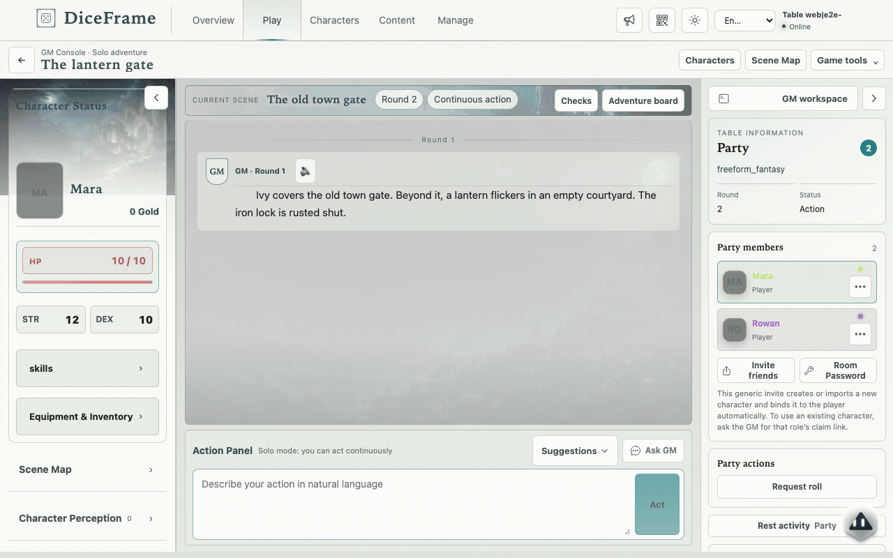

<p align="center">
  
</p>
<h1 align="center">DiceFrame</h1>
<p align="center">English | <a href="README_zh-CN.md">简体中文</a></p>
<p align="center"><a href="https://github.com/diceframe/diceframe/stargazers"></a> <a href="https://github.com/diceframe/diceframe/releases"></a> <a href="https://github.com/diceframe/diceframe/blob/main/LICENSE"></a></p>


DiceFrame is a self-hostable **AI tabletop RPG engine** supporting **D&D / CoC / custom rules** with a **multiplayer Web UI**.


*Real Web UI; demonstration game with scripted check results and GM replies.*

## Features

- Play solo or with friends in a browser, with invitations and shared game state.
- Describe actions naturally; rules handle automatic dice checks and character state.
- Build worlds, lorebooks and adventures, or import scripts, PDFs and supported modules.
- Reuse character cards and create worlds, rules and characters with AI assistance.
- Keep long campaigns with summaries, optional memory recall and text-to-speech.
- Add plugins and chat bots; use the owner-only DF Agent for reviewed operations.

## Quick start

<details>
<summary>Windows portable</summary>

Download `DiceFrame-vX.Y.Z-windows-portable.zip` from [Releases](https://github.com/diceframe/diceframe/releases/latest), extract it, and run `DiceFrame.exe`.
Add a provider under **Manage → Settings → Model API**, then assign the main model under **Model Routing**. [Installation details](docs/en/install.md#windows-portable) · [First game](docs/en/content-and-play.md#first-game)

</details>
<details>
<summary>Docker</summary>

From a [cloned repository](https://github.com/diceframe/diceframe) or extracted source release containing `docker-compose.yml`:

```bash
cp .env.example .env
# edit .env as needed
docker compose pull
docker compose up -d
```

Open <http://localhost:9876>, then configure your provider and model in Settings. Data stays in `data/`. [Docker details and updates](docs/en/install.md#docker)

</details>
<details>
<summary>From source</summary>

Requires Python 3.10+, Node.js 20.19+ or 22.12+, and an OpenAI-compatible Chat Completions endpoint.

```bash
git clone https://github.com/diceframe/diceframe.git
cd diceframe/frontend-v2
npm ci && npm run build
cd ..
pip install -r requirements.txt
python web_server.py
```

Open <http://localhost:18000>, then configure your provider and model in Settings. [Source and standalone frontend details](docs/en/install.md#from-source)

</details>

## Documentation

| Topic | English | 中文 |
|-------|---------|------|
| Content and play | [Content and play](docs/en/content-and-play.md) | [内容与游玩](docs/zh/content-and-play.md) |
| AI settings | [AI and interface settings](docs/en/ai-settings.md) | [AI 与界面设置](docs/zh/ai-settings.md) |
| Adventure creator starter | [Lantern Harbor](plugins/examples/starter-adventure/README.md) | [灯火港湾](plugins/examples/starter-adventure/README_zh-CN.md) |
| Translation policy | [Translation policy](docs/en/translations.md) | [翻译维护](docs/zh/translations.md) |
| User guide | [User guide](https://github.com/diceframe/diceframe-content/blob/main/docs/en/guide.md) | [用户手册](https://github.com/diceframe/diceframe-content/blob/main/docs/zh/guide.md) |
| Docker deployment | [Docker deployment](https://github.com/diceframe/diceframe-content/blob/main/docs/en/deploy.md) | [Docker 部署](https://github.com/diceframe/diceframe-content/blob/main/docs/zh/deploy.md) |
| Standalone WebUI | [Standalone WebUI](https://diceframe.com/en/docs?doc=standalone) | [独立部署 WebUI](https://diceframe.com/docs?doc=standalone) |
| Application updates | [Application updates](docs/en/updates.md) | [应用更新](docs/zh/updates.md) |
| Rules and dice | [Rules and dice](docs/en/rules-and-dice.md) | [规则与骰子](docs/zh/rules-and-dice.md) |
| Player Direct Connect (experimental) | [Player Direct Connect](docs/en/direct-connect.md) | [玩家直连](docs/zh/direct-connect.md) |
| Plugin development | [Plugin development](https://github.com/diceframe/diceframe-content/blob/main/docs/en/plugin-development.md) | [插件开发](https://github.com/diceframe/diceframe-content/blob/main/docs/zh/plugin-development.md) |
| Plugin index and review | [Plugin registry](https://github.com/diceframe/diceframe-content/blob/main/docs/en/plugin-registry.md) | [插件索引与审核](https://github.com/diceframe/diceframe-content/blob/main/docs/zh/plugin-registry.md) |
| Bot Bridge core | [Bot Bridge Core](https://github.com/diceframe/diceframe-content/blob/main/docs/en/bot-bridge-core.md) | [Bot Bridge 核心](https://github.com/diceframe/diceframe-content/blob/main/docs/zh/bot-bridge-core.md) |

[Documentation](docs/README.md) · [Website](https://diceframe.com) · [Issues](https://github.com/diceframe/diceframe/issues) · [Contributing](CONTRIBUTING.md) · [AGPL-3.0](LICENSE)
