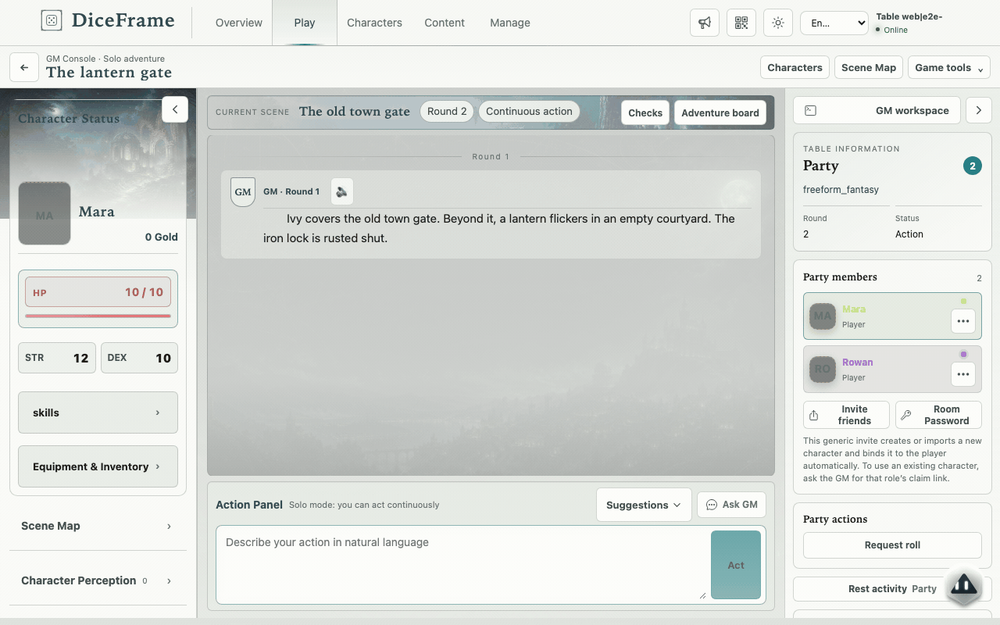

<p align="center">
  
</p>
<h1 align="center">DiceFrame</h1>
<p align="center"><a href="README.md">English</a> | 简体中文</p>
<p align="center"><a href="https://github.com/diceframe/diceframe/stargazers"></a> <a href="https://github.com/diceframe/diceframe/releases"></a> <a href="https://github.com/diceframe/diceframe/blob/main/LICENSE"></a></p>


DiceFrame 是一个可以自己部署的 **AI 跑团引擎**，支持 **D&D / CoC / 自定义规则**与**多人 WebUI**。


*真实 WebUI 录制；演示对局使用预设检定结果和 GM 回复。*

## 功能

- 在浏览器里单人游玩或邀请好友，共享同一份对局状态。
- 用自然语言描述行动，由规则处理自动检定与角色状态。
- 制作世界、资料册与冒险，或导入剧本、PDF 和支持的模组。
- 复用角色卡，用 AI 辅助生成世界、规则与角色。
- 用长团摘要、可选记忆召回与语音朗读延续冒险。
- 通过插件与群聊 Bot 扩展玩法，由房主 DF Agent 提供经审核的操作。

## 快速开始

<details>
<summary>Windows 便携版</summary>

从 [Releases](https://github.com/diceframe/diceframe/releases/latest) 下载安装版 `DiceFrame-vX.Y.Z-windows-setup.exe`（不需要管理员权限），或便携版 `DiceFrame-vX.Y.Z-windows-portable.zip`（解压后运行 `DiceFrame.exe`）。
在“**管理 → 设置 → 模型接口**”添加服务商，再到“**模型配置**”选择主模型。[安装详情](docs/zh/install.md#windows-便携版) · [第一局](docs/zh/content-and-play.md#第一局怎么玩)

</details>
<details>
<summary>Docker</summary>

在包含 `docker-compose.yml` 的[仓库克隆目录](https://github.com/diceframe/diceframe)或源码发布包目录中运行：

```bash
cp .env.example .env
# 按需编辑 .env
docker compose pull
docker compose up -d
```

打开 <http://localhost:9876>，在设置中配置服务商与模型。运行数据保存在 `data/`。[Docker 部署与更新详情](docs/zh/install.md#docker-运行)

</details>
<details>
<summary>从源码运行</summary>

需要 Python 3.10+、Node.js 20.19+ 或 22.12+，以及兼容 OpenAI Chat Completions 的模型服务。

```bash
git clone https://github.com/diceframe/diceframe.git
cd diceframe/frontend-v2
npm ci && npm run build
cd ..
pip install -r requirements.txt
python web_server.py
```

打开 <http://localhost:18000>，在设置中配置服务商与模型。[源码与独立前端部署详情](docs/zh/install.md#从源码运行)

</details>

## 文档

| 内容 | 中文 | English |
|------|------|---------|
| 内容与游玩 | [内容与游玩](docs/zh/content-and-play.md) | [Content and play](docs/en/content-and-play.md) |
| AI 设置 | [AI 与界面设置](docs/zh/ai-settings.md) | [AI and interface settings](docs/en/ai-settings.md) |
| 冒险作者示例 | [灯火港湾](plugins/examples/starter-adventure/README_zh-CN.md) | [Lantern Harbor](plugins/examples/starter-adventure/README.md) |
| 翻译维护 | [翻译维护](docs/zh/translations.md) | [Translation policy](docs/en/translations.md) |
| 用户手册 | [用户手册](https://github.com/diceframe/diceframe-content/blob/main/docs/zh/guide.md) | [User guide](https://github.com/diceframe/diceframe-content/blob/main/docs/en/guide.md) |
| Docker 部署 | [Docker 部署](https://github.com/diceframe/diceframe-content/blob/main/docs/zh/deploy.md) | [Docker deployment](https://github.com/diceframe/diceframe-content/blob/main/docs/en/deploy.md) |
| 独立 WebUI | [独立部署 WebUI](https://diceframe.com/docs?doc=standalone) | [Standalone WebUI](https://diceframe.com/en/docs?doc=standalone) |
| 应用更新 | [应用更新](docs/zh/updates.md) | [Application updates](docs/en/updates.md) |
| 规则与骰子 | [规则与骰子](docs/zh/rules-and-dice.md) | [Rules and dice](docs/en/rules-and-dice.md) |
| 玩家直连（实验性） | [玩家直连](docs/zh/direct-connect.md) | [Player Direct Connect](docs/en/direct-connect.md) |
| 插件开发 | [插件开发](https://github.com/diceframe/diceframe-content/blob/main/docs/zh/plugin-development.md) | [Plugin development](https://github.com/diceframe/diceframe-content/blob/main/docs/en/plugin-development.md) |
| 插件索引与审核 | [插件索引与审核](https://github.com/diceframe/diceframe-content/blob/main/docs/zh/plugin-registry.md) | [Plugin registry](https://github.com/diceframe/diceframe-content/blob/main/docs/en/plugin-registry.md) |
| Bot Bridge 核心 | [Bot Bridge 核心](https://github.com/diceframe/diceframe-content/blob/main/docs/zh/bot-bridge-core.md) | [Bot Bridge Core](https://github.com/diceframe/diceframe-content/blob/main/docs/en/bot-bridge-core.md) |

[文档](docs/README.md) · [官网](https://diceframe.com) · [问题反馈](https://github.com/diceframe/diceframe/issues) · [贡献指南](CONTRIBUTING.md) · [AGPL-3.0](LICENSE)
