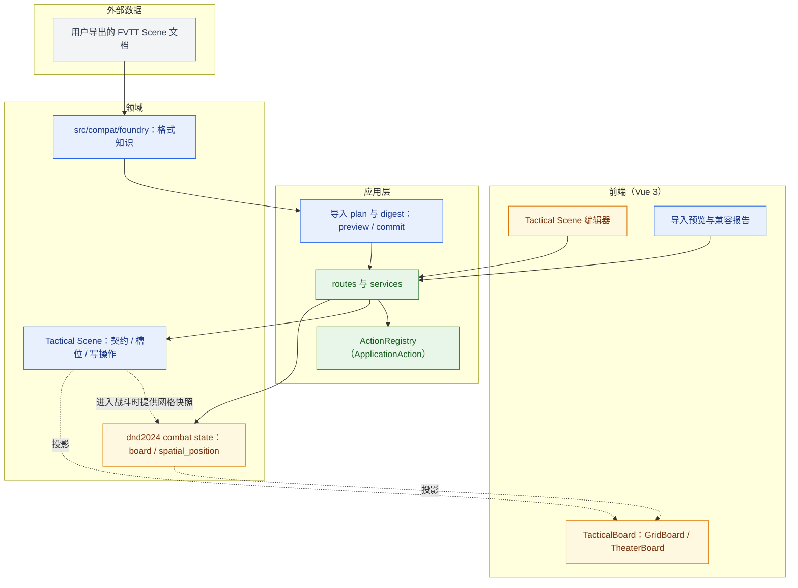

# FVTT 数据兼容与原生战术场景施工计划

> 文档性质：维护者内部连续工作文档。位于 `docs/internal/`，不得从玩家文档、网站或 `diceframe-content` 链接或引用，也不构成对外契约或 FVTT 官方兼容声明。
>
> 当前状态：**M1+M2+M3 全部施工并验收完成（2026-11-28，见 §18 台账）**，但**全部改动尚未提交**，在 main 的工作区里。共享契约已按实现冻结（§6）。ADR-0016 已 Accepted（ROAD 加法方案）。剩余非阻塞打磨项与外部轨道审计残留见 §18 末行。本文仍为维护者内部施工文档，尚未作为产品契约发布；对外表述须维护者确认。
>
> 文档 owner：集成验收角色（当前指派见 §11.1）。
>
> 取代：`FVTT_REPLACEMENT_WORKPLAN.md`（v1，`RETIRED`）。v1 及其上累积的 B0 至 foundry-02 的进度记录已并入本文。仓库里只保留本文。
>
> 目标：以兼容 Foundry VTT 的**数据**为主要方向，把用户已有的场景和内容带进 DiceFrame；按 DiceFrame 自身的产品形态吸收 FVTT 的好设计，建设原生战术场景（Tactical Scene）；并与 D&D 2024 计划阶段三的 2D 战斗合并为同一条施工线。
>
> 非目标：不替代 Foundry VTT，不运行第三方 FVTT 模块，不做双向同步。
>
> 更新日期：2026-11-28
>
> 代码基线：`main@7ee5c2fb`（v3.4.0），加未提交的场景后端改动。这些改动目前没有任何备份，见 §0.5。

本文用于连续协调前端执行角色、后端执行角色、集成工作和 PR 验收。每次实现、拆分、合并、回滚或重大决策都应在本文更新对应章节。本文只记录内部施工计划、未发布设计和验收状态。

## 0. 使用约定

### 0.1 状态标记

| 标记 | 含义 |
|---|---|
| `PROPOSED` | 设计提案，尚未冻结 |
| `FROZEN` | 已经作为当前施工契约使用 |
| `IN_PROGRESS` | 已有实现工作 |
| `VERIFIED` | 已通过指定测试和验收，或事实已按注明的方式核实 |
| `DEFERRED` | 有意推迟，保留原因和重启条件 |
| `BLOCKED` | 由外部状态或明确决策阻塞 |
| `RETIRED` | 已被新契约取代 |

### 0.2 更新规则

1. 先核对当前源码、架构文档、工程规则和 ADR，再更新计划。
2. 设计提案必须标为 `PROPOSED`，不得写成当前已经存在的能力。
3. 任何改变 persisted schema、权限、多人 authority、规则 mechanics、插件 contract 或公开 API 的决定，必须同时记录 migration、测试和回滚范围。
4. FVTT 的外部字段只通过兼容边界（§4.4 的 `src/compat/foundry/`）进入 DiceFrame。业务代码不得读取原始 FVTT payload。
5. 每个 PR 完成后更新变更文件、测试命令、剩余风险和下一步依赖。
6. 发现实现偏离本文时，先修正本文的状态和契约，再决定是否修代码。不能用文档掩盖实际代码状态。
7. 任何无法证明安全的迁移都应 fail closed，不猜测用户意图，不自动创建规则系统、服务商、引用或世界实体。
8. 本文引用的外部事实（FVTT 字段、上游提交、许可证条款）必须标注来源和核实日期。未能核实的写明“未核实”，不得写成事实。
9. 某个契约冻结之后如果继续膨胀，把它拆到独立文档（`docs/internal/design/` 下的契约文档或 ADR），本文只保留指针和状态。
10. 本文内部不使用“替代 FVTT”作为目标描述。任何“替代 FVTT”“FVTT 兼容”的表述进入对外文档前，必须经维护者确认。
11. 本文是这条轨道唯一的工作文档。不得再从 v1 或它的旧章节号派生任务。代码注释里引用的章节号一律指向本文。

### 0.3 v1 → v2 的变更摘要

v1 把目标定为“可逐步替代 Foundry VTT”。v2 改为“兼容数据、吸收好功能、建设原生战术场景”。执行角色不得再引用 v1 的目标态架构。

| # | v1 的写法 | v2 的写法 | 原因 |
|---|---|---|---|
| 1 | 目标是替代 FVTT，L1–L5 全部验收 | 目标是兼容数据；L5 生态、Foundry Bridge、Sandbox 移出范围 | 见 §1.1 |
| 2 | Token 位置一律归 Scene Runtime | 按“战斗中 / 非战斗”划分 authority，战斗中归规则集 combat state；先出 ADR | 与 D&D 2024 计划阶段三冲突，见 §3.1 |
| 3 | 新建 `src/packages/`、Action Registry、Foundry Bridge、Document Core | 复用现有 owner；只新建 Tactical Scene 和 Foundry 兼容适配器 | 避免重复 owner，见 §2 |
| 4 | 用一个 D&D5e adapter 打通规则闭环 | dnd5e 数据只做转换，进入现有 dnd2024 runtime，不新建规则执行层 | 见 §3.2 |
| 5 | 第一个里程碑不清，最终门槛接近完整 FVTT | 第一个里程碑收窄为场景导入、原生战术场景读写和 D&D 2D 战斗，其余 `DEFERRED` | 见 §5 |
| 6 | 导出回 FVTT 是硬性 round-trip 要求 | 降为远期项；导入时保留外部 ID 和未知字段，不堵死将来的导出 | 见 §8.5 |
| 7 | Scene 的持久化槽位只列为“待决策” | 槽位归属和 hook 接入点是 `scene-01` 的先决条件，并受现有门面基线测试约束 | 见 §6.1 和 §12 |
| 8 | 导出只剥离 room/seat token 和密码 | 凭据剥离范围按代码现状补全 | 见 §8.4 |
| 9 | LevelDB 由版本化 adapter 读取 | 第一版只接收 JSON、JSONL、YAML 源文件；LevelDB `DEFERRED` | 见 §7.3 |
| 10 | 正文写死模型名和版本，owner 写具体工具名 | 角色名保持稳定，当前指派集中在一张表 | 见 §11.1 |
| 11 | 没有 v13 / v14 的具体差异 | 新增已核实的格式事实表和样本必答清单 | 见 §7 |
| 12 | 许可只有一句 | 新增许可分层：代码、SRD 内容、美术资源、FVTT 本体、付费内容 | 见 §15.4 |

### 0.4 v2 → v2.1：与已施工代码的对账

v2 写完之后，后端基础是按 v1 的契约施工的。v2.1 把两边对齐：目标、命名和位置归属维持 v2 的裁定；已经实现并且工程上站得住的，接受现状，不返工。

| # | 事项 | 已施工的现状 | v2.1 裁定 |
|---|---|---|---|
| 1 | 目标 | 工作文档仍写“替代”，后续轨道里有 Package Runtime、Document Core、插件 SDK、Bridge | 维持 v2。这些轨道 `RETIRED`，见 §5.4 |
| 2 | 命名 | `scene_runtime`、`src/scene/`、`scene_*`，约 7600 行，全部未提交 | 维持 v2，趁未提交改名。已由 `scene-00` 完成，见 §9 |
| 3 | Token 位置 | 已冻结的契约写着“位置权威属 Scene Runtime” | 维持 v2。这句话作废，由 ADR-0016 接替。依赖它的任务要等 ADR 变为 `Accepted` |
| 4 | Scene 坐标 | 画布像素 | 接受现状。像素是存储坐标，格与像素的换算放在渲染层，以及规则集取网格快照的时候 |
| 5 | 导入管线 | 独立的 plan 和 digest（`src/compat/foundry/import_plan.py`），原子提交 | 接受现状，不返工。登记为将来与 `content_modules` 收敛的后续项 |
| 6 | 槽位的 hook | 没有登记任何 hook | 待定，见 §19 第 6 项 |
| 7 | 实例 schema 版本 | 不提升 `instance_schema_version`。理由是槽位可选，旧运行时保留未登记的槽位 | 接受 |
| 8 | 导出 | 已实现 v14 导出和 round-trip 测试 | 接受为已有能力，但不扩展。对外仍不承诺导出 |
| 9 | 执行角色 | 后端由 DeepSeek Flash 执行 | 今后后端执行角色改为 GLM-5.3-Flash（Start Plan）。前端仍是 Qwen。见 §11.1 |

### 0.5 当前进度快照（2026-11-28）

接手的人先读本节，再读 §6（契约）和 §18（台账）。

#### 已完成的增量

| 增量 | 范围 | 状态 | 执行 | 验收 |
|---|---|---|---|---|
| B0 | 共享契约冻结（原 v1 §5.6，现 §6） | `VERIFIED` | Codex | Codex |
| B1 / scene-01 | Scene 的 typed contract、codec、`scene_runtime` 槽位 | `VERIFIED` | DeepSeek Flash | Codex |
| B2 / scene-02 | 读投影（GM 全量、seat 白名单）、读 API、action | `VERIFIED` | DeepSeek Flash | Codex |
| B3 / foundry-01 | FVTT v13 / v14 Scene 转换，v14 导出与 round-trip 样本 | `VERIFIED` | DeepSeek Flash | Codex |
| scene-03 | Scene 与 placeable 的增删改、authority、stale guard、保存失败回滚、SSE | `VERIFIED` | DeepSeek Flash | Codex |
| foundry-02 | FVTT Scene 导入的 preview 与 commit（digest、幂等、原子） | `VERIFIED` | DeepSeek Flash | Codex |
| scene-00 | 改名：代码标识符带 `tactical_scene` 前缀 | `VERIFIED` | GLM-5.3-Flash | ZCode |
| scene-04 | 墙、光源、注记的类型契约、转换、投影 | `VERIFIED` | ZCode | ZCode |
| 遗留 3/4/8 | Agent 动作补全：`tactical_scene_delete` 注册、Agent 写路径 SSE 广播、跨版本 external-id 匹配 | `VERIFIED` | ZCode | ZCode |

前六个增量按 v1 的契约施工，由 Codex 验收。v2.1 的集成验收角色复跑了基线测试，并做了契约层面的对账（§0.4），没有逐行复审代码。`scene-00` 由集成验收角色完整验收，见 §9。`scene-04` 和三个遗留项由集成验收角色直接实现并自验，见 §9 与 §18。

验证命令。这个检出目录没有 `.venv`，用系统自带的 Python：

```bash
python -m pytest tests/test_tactical_scene_runtime_contract.py tests/test_tactical_scene_projection.py \
  tests/test_tactical_scene_read_api.py tests/test_tactical_scene_ops.py tests/test_foundry_scene_adapter.py \
  tests/test_foundry_import.py tests/test_error_codes.py tests/test_localization_audit.py tests/architecture -q
```

2026-11-28（scene-04 之后）的结果：**316 passed**，退出码 0。另跑 action 目录与路由注册回归 9 个文件，85 passed。

#### 后端现在能做什么

- 导入 FVTT v13 / v14 场景：先预览（转换报告、冲突标记、`plan_digest`），再提交（`create`、`update`、`duplicate`、`skip`）。墙、光源、注记转换成类型化文档；跨版本的 external-id 命中走 update，不产生重复场景。
- 场景的增删改，placeable 的增删改，设置当前场景。一律 GM-only，经过 authority 门禁、stale guard、保存失败回滚，写后按白名单广播。Agent 动作与 HTTP 写共用同一条 SSE 广播（组合根已接线连接池）。
- Agent 动作齐全：读、可见性、创建、更新、删除、placeable 增删改、设当前场景，外加导入的预览和提交。
- GM 全量读取。玩家按白名单读取：Token、墙、可见光源；注记只给 GM。
- v14 导出。

#### 还没有的

- 前端画布。游戏里还看不到场景。
- 玩家移动、可见性规则、战斗与场景的连接。
- 角色、物品、日志文档。内容包与合集包导入。
- Tile、声音、绘图、模板、Region 仍是 opaque（保存与显示残差，不解释）。

#### 改动文件（全部未提交）

新增：

- `src/tactical_scene/`：`__init__`、`contract`、`codec`、`projection`、`ops`。
- `src/compat/foundry/`：`__init__`、`common`、`report`、`placeables`、`scene_adapter`、`import_plan`。
- `src/engine/modules/tactical_scene.py`。
- `src/webui/services/`：`tactical_scene_read`、`tactical_scene_ops`、`foundry_import`、`assistant_tactical_scene_tools`、`assistant_foundry_tools`。
- `src/webui/routes/`：`tactical_scene`、`foundry`。
- `src/localization/locales/webui/services/`：`tactical_scene_read`、`tactical_scene_ops`、`foundry_import` 的 `zh-CN` 和 `en`。
- `tests/test_tactical_scene_*.py`、`tests/test_foundry_*.py`、`tests/fixtures/foundry/`。
- 本文、`docs/adr/0016-tactical-scene-position-authority.md`。

最小修改：

- `src/engine/modules/__init__.py`，加一行导入。
- `src/webui/api.py`，薄委托、依赖组装、`attach_connection_pool`。
- `src/webui/bootstrap.py`，连接池接线一行。
- `src/webui/application.py`，路由注册。

**目前没有备份。** 改名之前做过一份工作区备份（53 个文件），用于 `scene-00` 的语义对比。验收完成后，这份备份在 2026-11-28 被维护者删除。上面这些文件现在只存在于工作区，而且全部未提交。

提交由维护者决定。提交之前检查最终的 changed-file list。

#### 已知限制与待办

1. 玩家的 actor 所有权没有解析。seat 投影的 `owned_actor_refs` 注入点已经留了，组合根没有接。非公开 disposition 的 `actor_ref` 置 null。
2. Tile、声音、绘图、模板、Region 仍是 opaque：保存与显示残差，不解释。墙、光源、注记已有类型契约（§6.12）。
3. 公开 token 的 disposition 枚举是 `{-1, 0, 1}`；墙和光源给 seat，注记只给 GM。这些默认已按 §6.5 落地，最终取值随可见性规则确认。
4. FVTT 样本都是按官方 API 手写的合成数据。真实的导出样本没有验证。
5. 槽位没有登记任何 hook。回合回滚时，场景状态不跟着回退。见 §19 第 6 项。
6. 位置归属的裁定（§3.1、ADR-0016）还是提案，等维护者确认。
7. 墙的词汇表（`dir`、`door`、`ds`、阻挡四值）只校验已知整数范围，含义不解释；真实样本确认前不用于规则。嵌套残差结构（墙的 threshold、光源的 animation）字段名未对真实导出核对。
8. 已解决（原限制 3、4、8）：Agent 写路径的 SSE 广播已接线；`tactical_scene_delete` 已注册为 action；跨版本 external-id 命中已走 update 并有测试。`scene_adapter.py` 已拆分为 `common`、`placeables` 与适配器本体，全部低于 1500 行热点线。

#### 下一步，按角色

后端执行角色依次做：

1. `scene-05`：槽位的 hook 与回滚语义（先解决 §19 第 6 项）。
2. ADR-0016 变为 `Accepted` 之后，`combat-01`。

前端执行角色现在就可以开工，路由名和 action 名已经定型：`frontend-00`、`frontend-01`、`frontend-04`，任务包见 §10.5。

## 1. 目标与非目标

### 1.1 为什么不是“替代”

1. **最难的部分赢不了，也没有必要去赢。** FVTT 真正的护城河是第三方生态：大量模块和系统直接调用 Foundry 客户端 API 的 JavaScript。要兼容它们，就得重新实现 Foundry 的客户端运行时。v1 自己也承认“不能承诺任意模块兼容”，却仍为 Bridge、Sandbox、Hook 映射安排了大量篇幅。这部分投入产出比最低。
2. **产品形态不同。** FVTT 服务于真人 GM 的手动操作。DiceFrame 的核心是 AI GM、服务端规则权威、LLM 叙事和自托管多人。按 FVTT 的功能清单逐项补齐，会把精力从自身优势上挪开。
3. **用户被锁住的是内容，不是界面。** 用户手里已有的场景、角色、合集包和冒险才是迁移成本所在。把这些带过来只需要数据导入。
4. **许可边界更清楚。** FVTT 核心闭源。其 EULA 写明用户保留在软件内创建的个人数据的所有权，因此“只处理用户自己合法导出的数据”有明确的依据；而开发在 FVTT 内运行的 Bridge 模块受另一套条款约束。详见 §15.4。
5. **工期。** 按 v1 的最终门槛施工是年级别的工程。收窄后，第一个里程碑可以在可预期的时间内交付。

### 1.2 目标

| 编号 | 目标 | 成功标准 |
|---|---|---|
| T1 | FVTT 数据导入，单向，先预览后提交 | 用户合法导出的数据能进来、能显示、来源可追溯；不支持的部分有结构化报告 |
| T2 | 原生战术场景（Tactical Scene） | GM 可以创建和编辑场景对象；玩家只看到权限允许的投影；保存、回滚和多人同步可用；没有 Scene 时现有玩法不变 |
| T3 | 与 D&D 2024 的 2D 战斗合并为一条线 | 战斗中拖拽提交 move intent，服务端校验移动预算；现有 1D 机制平移到 2D；AI GM 通过同一 intent 通道行使空间权威 |
| T4 | 吸收 FVTT 的好设计 | §1.5 列出的设计落到 DiceFrame 自己的 feature 里，不复制 FVTT 的界面和 API 形状 |

### 1.3 非目标

以下内容不在本计划的施工范围内。执行角色不得在任务包里自行加入：

- Foundry Bridge 或任何与 FVTT 的双向同步。
- 运行第三方 FVTT 模块、宏、脚本或模块代码。
- FVTT Hook、Socket 的映射，以及为第三方代码提供的 Sandbox。
- 通用 Document Core 的完整外壳（Playlist、RollTable、Folder 等全套文档类型）。
- 画面与 FVTT 保持一致，或复制 FVTT 的视觉皮肤。
- 破解加密合集包，或分发受版权保护的内容。
- 导出回 FVTT。这是远期项，状态 `DEFERRED`，重启条件见 §8.5。
- 在任何对外材料中使用“替代 FVTT”或无限定的“FVTT 兼容”。

### 1.4 兼容等级的重定位

v1 的 L1–L5 分级本身有价值：“导入成功”不能代表规则兼容或模块兼容。v2 保留分级，但不再把五级全部当作目标。

| 层级 | 含义 | v1 的定位 | 现在的定位 |
|---|---|---|---|
| L1 数据 | 能读取 FVTT 的文档和包内容 | 目标，要求 round-trip | **核心目标。** 单向导入，先预览后提交；v14 优先，v13 尽力而为；导出降为远期 |
| L2 画面 | 地图和桌面行为 | 目标，表现接近 FVTT | **按自身需要吸收。** 做原生 Tactical Scene；FVTT 只是导入来源和设计参考 |
| L3 规则 | 规则系统的派生数据和动作结果 | 由规则系统 adapter 负责 | **只做数据转换。** dnd5e 数据转换进现有 dnd2024 runtime，不新建规则执行层 |
| L4 协作 | 多人、权限、同步 | 目标 | **不是兼容目标。** DiceFrame 已有自己的多人 authority，场景接入它即可 |
| L5 生态 | 模块、系统、扩展 | 目标 | **移出范围。** 只读取 manifest 和包内容；Bridge、Sandbox、Hook/Socket 映射不做 |

每个导入对象仍分别报告，不得用“导入成功”代替兼容声明：

- `data_preservation`：原字段是否保存。
- `visual_projection`：是否能正确显示。
- `mechanics_execution`：是否能通过现有 runtime 执行同等规则。
- `round_trip`：仅对已声明支持的导出对象评估。
- `degradation`：不支持的部分如何报告。

### 1.5 值得吸收的 FVTT 设计

筛选标准只有一条：**能不能让 AI GM 的游玩体验变好。**

| FVTT 的设计 | 在 DiceFrame 的落点 | 状态 |
|---|---|---|
| 战术场景的分层画布（墙、视线、迷雾） | Tactical Scene 的图层和可见性 capability；与 AI GM 的空间权威结合，这是 FVTT 自己做不到的 | `PROPOSED`，M1 起步，迷雾和光照延后 |
| 测量模板和范围效果预览 | Canvas 测量层、模板预览层；为几何 AoE 提供前端表现 | `PROPOSED`，M1 后期 |
| 日志与地图注记绑定 | 地点或 Token 到叙事资料的显式引用 | `PROPOSED`，M1 只做只读注记 |
| 合集包式的内容浏览、搜索、拖放 | 现有内容库和内容包界面的交互改进 | `DEFERRED`，随 M3 |
| Active Effect 的来源、条件和应用顺序 | 作为 dnd2024 效果原语的**建模参考**，归 D&D 2024 计划的效果原语层 | 不在本计划施工，见 §3.2 |

吸收的是设计，不是实现：

- 不复制 FVTT 的页面形状和 API 命名。
- 不从 Foundry 核心复制代码。核心闭源，只能参考公开的 API 文档。
- dnd5e 系统的代码可以研究，许可边界见 §15.4。

### 1.6 对外表述

| 可以说 | 不可以说 |
|---|---|
| 可以导入 Foundry VTT 导出的场景数据，并说明支持的版本和对象 | 替代 FVTT |
| 支持 Foundry VTT v14 场景导入，v13 尽力支持 | FVTT 兼容、完全兼容 FVTT |
| 不支持的内容会在导入报告中列出 | 支持所有 FVTT 模块或系统 |
| 原生战术场景，支持网格、Token、墙和测量 | 与 FVTT 画面一致 |

在里程碑验收通过前，任何能力都只能作为内部目标描述，不能写成已交付能力。

## 2. 现有 owner 对照表

v1 列现有能力时漏掉了 `application_actions`、`content_modules`、`gameplays`，也漏掉了仓库里已有的 Foundry 导入代码。结果是 v1 把已有的能力写成了缺口，再为这些“缺口”新建了一套平行的 owner。本节是裁定。

代码事实基线：`main@7ee5c2fb`（v3.4.0），2026-11-28 核实。路径以这个提交为准。

下文把 `docs/internal/plans/gameplay-ux-combat-roadmap.md` 简称为 ROAD，把 `docs/internal/plans/hd2d-gameplay-ux-master-plan.md` 简称为 HD-2D。

### 2.1 处置原则

- **复用**：已存在且职责相同的 owner，直接扩展，不新建平行实现。
- **扩展**：已存在但缺少能力位或数据的，在原 owner 内按它的 contract 扩展。
- **新建**：确认没有 owner 之后才新建，并且先写明 owning module。
- **术语**：沿用现有计划已经提出的词汇，不再造第四套。

### 2.2 对照表

“现状”一列记录 2026-11-28 已施工的代码。

| 能力 | 现有 owner | v1 的提议 | 裁定 | 现状 |
|---|---|---|---|---|
| 应用动作目录 | `src/application_actions.py` 的 `ApplicationAction` 和 `ActionRegistry`（ADR-0011） | 新建 "Action Registry"，带 audience、permission、idempotent、P2P 字段 | **复用。** 用户或 Agent 可执行的场景能力，按 `ENGINEERING_RULES.md` §21.6 在 owning module 注册为 `ApplicationAction`。不新建注册表 | 已按此实现：`assistant_scene_tools.py`、`assistant_foundry_tools.py` |
| 战斗意图 | `RulesetRuntime` 的 `available_intents` / `validate_intent` / `resolve_intent` / `apply_event_batch`（`src/rulesets/contracts.py`） | 规则系统经 Scene 的 movement capability 改位置 | **复用。** 战斗中的移动仍然走 ruleset intent。场景不定义第二套 movement API | 未开工 |
| 能力声明 | `RulesetCapabilities`（`src/rulesets/contracts.py`） | 规则系统声明 movement、vision、measurement、combat 的支持范围 | **扩展。** 按 ROAD 和 HD-2D 已提出的 `theater`、`zone`、`grid` 声明空间模式 | 未开工 |
| 内容导入管线 | `src/content_modules/`：`refs.py` 的 `ContentRef`、`plan.py` 的 `plan_digest`、`sync.py` 的 `preview()` / `commit(confirmed_digest, decisions)` | 新建 `src/packages/` Package Runtime | **接受现状。** 场景导入的 plan 和 digest 是独立实现（`src/compat/foundry/import_plan.py`），提交是原子的。不返工，登记为与 `content_modules` 收敛的后续项 | 已实现 |
| FVTT 冒险文档导入 | `src/adventures/importers/foundry.py` 的 `parse_foundry`，测试 `tests/test_external_adventure_import.py` | 未提及，写成“当前缺少 FVTT 适配” | **保留，并沿用它的边界约定。** 它已经把 FVTT 冒险导出里的 journal、actors、items、scenes 转成仅 GM 可见的资料 | 未改动 |
| FVTT / Fantasy Grounds 模块元数据 | `src/webui/services/module_import_adapters.py` 的 `preview_external_module_import`，产物 `auto_installable: False` | 未提及 | **保留。** L5 移出范围后，这就是 FVTT Module 在 DiceFrame 的全部处理方式：只读 manifest，不可安装 | 未改动 |
| 内容包（“模块”） | `src/plugin_host/` 的 `content-pack` 类插件、`src/content_modules/`、前端 `features/modules/` | 新建 Package Runtime | **复用。** FVTT Module 不是 DiceFrame 插件，不得映射为可执行插件 | — |
| 玩法包 | `src/gameplays/` 的 `GameplayMode`、`GameplayRegistry`（ADR-0013） | 未提及 | **不扩展。** 本计划不新增玩法 | — |
| 规则动作模型 | dnd2024 的 catalog 与 intent（`src/rulesets/dnd2024/combat/catalog.py`） | 把 dnd5e 的 Activity 映射为跨规则集的 `ActionDefinition` | **不做映射。** 不建跨规则集的 `ActionDefinition`，见 §3.2 | — |
| "Bridge" | `src/plugin_sdk/bridge_runtime.py`：聊天平台 Bridge 扩展 | 新建 Foundry Bridge | **术语保留给 Bot 扩展。** Foundry Bridge 不做 | — |
| "Scene" | 代码里至少 14 种含义，几乎全是叙事意义，见下表 | 新建通用 "Scene Runtime" | **代码标识符一律带 `tactical_scene` 前缀。** 见 §2.3 | `scene-00` 已完成，标识符带前缀 |
| 地点关系图 | `src/webui/routes/maps.py`、`src/webui/services/maps.py`、`src/webui/map_domain/`，前端 `components/play/MapGraph.vue` | 把它升级成 VTT 场景地图 | **保持分离。** ROAD §4 第 7 条、HD-2D §8 第 7 条：叙事地点图和战术图是两个投影，不共享坐标语义 | — |
| D&D 战斗 HUD | 前端 `features/rulesets/dnd2024/combat/hud/`。`battleView.ts` 按 `position_mode` 注册布局，目前只有 `theater: 'line'` | 另建通用 Scene Canvas | **扩展。** `grid` 模式在这里注册新布局（ROAD 的 `GridBoard`），不另起 HUD | — |
| 地图背景 | `media` 模块的 `map_background`（`src/engine/modules/media.py`） | 作为兼容来源 | **保持。** 见 §12 | — |
| 持久化槽位 | `src/engine/module_state.py` 的 `ModuleStateSpec`、`register_module_state` | 列为“待决策” | **能力模块槽位，不进内核。** 见 §6.1 | 已实现为 `tactical_scene` 槽位，没有登记 hook |
| 存档导出的凭据剥离 | `scrub_access_credentials`（`src/engine/modules/room_access.py`），存档导出、导入、重绑、回滚都调用 | 只写了 room/seat token 和密码 | **现状已经覆盖。** AI provider 凭据从不进存档，见 §8.4 | — |
| FVTT 格式知识 | 分散在 `src/adventures/importers/foundry.py` 和 `module_import_adapters.py` | 新建 `src/compat/foundry/` | **新建，但只放格式知识。** `ARCHITECTURE_CN.md` §55：旧格式适配归 `compat` | 已实现 `src/compat/foundry/` |

"scene" 在当前代码里的主要含义：

| 含义 | 位置 |
|---|---|
| 叙事场景标签，一个纯文本字符串 | `src/engine/modules/narrative_notes.py` 的 `scene`，存于 `modules.narrative_notes.scene` |
| 场景配图引用 | `media` 模块的 `scene_image` |
| GAL 的进度模式 | `src/engine/modules/progression_state.py` 的 `SCENE` |
| 冒险图节点类型、冒险包实体 | `src/adventures/graph_v2.py`、`src/adventures/bundle.py` |
| 提示词里的当前节点事实 | `src/adventures/scene_context.py`，规则集契约 `CurrentSceneRuntime` |
| 叙事标签 `SCENE`、`SCENE_IMAGE`、`SCENE_PANEL` | `src/commands/tag_parser.py` |

### 2.3 术语裁定

| 术语 | 含义 | 使用范围 |
|---|---|---|
| Tactical Scene | DiceFrame 自己的战术地图实体：背景、网格、墙、Tile、Token 实例、注记 | 代码、文档、对外 |
| `board` | 一场战斗开始时从 Tactical Scene 取出的网格快照，存在 combat state 里 | 规则集 combat state |
| `spatial_position` | 战斗中某个 actor 的二维位置和体积 | 规则集 combat state |
| `theater`、`zone`、`grid` | 三种空间模式。旧存档和未声明的规则集保持 `theater` | `RulesetCapabilities`、combat state |
| `TacticalBoard`、`TheaterBoard`、`GridBoard` | 前端渲染器 | 前端 |
| Foundry Scene、Foundry 文档 | FVTT 的 `Scene` 等文档类型 | 仅 `src/compat/foundry/` |
| FVTT Module | FVTT 生态的代码或内容包，不是 DiceFrame 插件 | 仅兼容边界和文档 |
| 场景（不带前缀） | 叙事场景 | 保持现有含义 |

`board`、`spatial_position`、三种空间模式和三个渲染器的名字来自 ROAD §5 和 HD-2D §7。HD-2D 把地图数据叫 `SceneMap`。本文用 Tactical Scene 指实体，`board` 指战斗内快照。名字在 ADR-0016 里统一。

**带前缀的是代码标识符，不是载荷里的词。** 槽位名、模块、包、service、route、action、事件类型、错误码、消息键、op kind 都写 `tactical_scene`。文档载荷里的词汇保持 FVTT 的对象名，例如 `kind: "scene"`、`tokens`、`walls`、字段名。这些是导入来源的文档类型，不是 DiceFrame 的标识符。界面上的显示名走 locale，可以是“场景”。

## 3. 相邻计划的冲突裁定

涉及战术地图的内部计划一共四份。v1 是其中唯一把 Token 位置交给场景的。另外三份和当前代码一致：位置在规则集的 combat state 里。

| 计划或代码 | 位置归属 | 字段形状 | 状态 |
|---|---|---|---|
| `DND2024_FULL_EXPERIENCE_PLAN.md` 阶段三 | reducer / EventBatch | `positions: {actor: int}` 改为 `{actor: [x, y]}` | 未开始 |
| `plans/gameplay-ux-combat-roadmap.md` §5 | “二维战斗由对应 ruleset runtime / reducer 拥有” | 保留 `position: number`，新增 `position_mode: "grid"`、`board`、`spatial_position` | 待确认方案，未改代码 |
| `plans/hd2d-gameplay-ux-master-plan.md` §7 | “D&D runtime/reducer 拥有” | 同 ROAD | 待确认方案，未改代码 |
| 已施工的场景后端（v1 契约） | 契约写“Token 位置权威属 Scene Runtime”。玩家移动没有实现 | 场景坐标是画布像素 | 这句话作废，由 ADR-0016 接替 |
| 当前代码 | dnd2024 的 `combat.positions`，由 `dnd2024.position.changed` 事件经 reducer 修改 | `{actor: int}`，`position_mode: "theater"`（`src/rulesets/dnd2024/combat/engine.py`） | `VERIFIED` |

generic combat engine 里没有位置概念：`CombatState` 只有 `entities`、`hp_resource`、`barriers`、`buffs`。位置是 dnd2024 规则集自己的状态。

### 3.1 Token 位置的 authority

状态：`Accepted`（2026-11-28，维护者授权集成验收角色裁定）。ADR-0016 已 Accepted (local implementation; unreleased)，依赖它的任务（combat-01 等）解锁。

#### 3.1.1 结论

按“是否处于战斗中”划分：

| 状态 | 权威 owner | 写入口 | Tactical Scene 的角色 |
|---|---|---|---|
| 非战斗：探索、GM 摆放、Freeform、没有战斗的 CoC | Tactical Scene 模块槽位 | 场景写操作，带 revision 和权限检查 | 权威 |
| 战斗中的参战 Token | 规则集 combat state 的 `spatial_position` | ruleset intent，经 reducer | 投影和输入面。拖拽只生成 move intent |
| 战斗中的非参战对象：墙、Tile、光照、未参战的 Token | Tactical Scene 模块槽位 | 场景写操作 | 权威 |

#### 3.1.2 进入和离开战斗

- **绑定是显式的。** 战斗记录一个 `board`：从 Tactical Scene 取出的网格尺寸、格距和阻挡信息，外加指向来源的 `scene_ref`。不按名称匹配。
- **进入战斗。** 参战者的初始 `spatial_position` 由绑定时的 Token 位置一次性生成，作为可重放的事件。旧存档没有空间信息时禁止猜测。
- **战斗进行中。** 前端拿到的每个 Token 坐标只有一个来源。服务端在投影里标明 authority 是 `scene` 还是 `combat`。前端不得自己合并两份坐标。
- **离开战斗。** 用一次显式的场景写操作把最终位置写回 Tactical Scene，带 revision 检查。场景在此期间被改过就不写回，并报告冲突，不静默覆盖。
- **回滚。** 战斗位置随 combat state 回滚。Tactical Scene 的状态如何回滚，见 §19 第 6 项。

#### 3.1.3 字段形状的冲突

D&D 计划和 ROAD 在 authority 上一致，在字段形状上不一致：

- D&D 计划阶段三：把 `positions` 的值从整数改成 `[x, y]`。
- ROAD §5.1：“不能直接把 `position:number` 改成 union，以免污染旧存档、旧事件和所有现有消费者。”

倾向 ROAD 的加法方案：保留 `theater` 的 `position`，新增 `position_mode: "grid"`、`board`、`spatial_position`。理由：

1. 旧存档、旧事件和现有消费者不需要改动。
2. 现有 zone 已经带 `projection: "theater_1d"`。“加新键、不改旧值”是仓库已有的做法。
3. `battleView.ts` 已经按 `position_mode` 注册布局，未知模式降级为名单而不是猜坐标。

最终由 ADR-0016 裁定。执行角色在 ADR 变为 `Accepted` 之前，不得按任何一种形状写代码。

#### 3.1.4 依赖方向

规则集不 import Tactical Scene 模块。规则集声明它需要的空间输入，由应用服务从 Tactical Scene 取好后作为显式输入传入。这和 ROAD §4 第 3 条一致：后端只提供 capability、projection 和合法 action。

#### 3.1.5 AI GM 的空间权威

AI GM（`dnd2024/director/` 的 encounter planner）通过同一条 intent 通道提交站位、移动和 AoE，不直接写坐标。这是 D&D 计划阶段三写明的差异化方向，也是本计划吸收 FVTT 设计时唯一要坚持的结合点。

#### 3.1.6 ADR 必须回答的问题

按 `ENGINEERING_RULES.md` §18，这是会长期存在、有多个可行方案、涉及 persistence 和 runtime model 的决策，需要 ADR。ADR-0016 的草案按下面六条写：

1. §3.1.1 的划分。
2. 字段形状（§3.1.3）。
3. 进出战斗的同步规则（§3.1.2）。
4. 规则集与应用服务之间的依赖方向（§3.1.4）。
5. 术语统一：Tactical Scene、`SceneMap`、`board`、`tactical_scene` 前缀。
6. 回滚和重置语义。

ADR 的索引条目在 `docs/adr/README.md` 的提案列表里。`tests/architecture/test_adr_index.py` 的目录契约要一起通过。

### 3.2 dnd5e 数据的定位

状态：`PROPOSED`。

v1 计划“用一个 D&D5e adapter 打通 Actor、Item、Activity、Active Effect 的最小闭环”。这条路线已经否决。规则如下：

1. **不新建规则执行层。** 不实现 dnd5e 的派生数据、Activity 或 Active Effect 解释器。DiceFrame 已经有完整的 dnd2024 runtime：职业特性、法术原语 P1–P9、战斗 reducer。
2. **只做转换。** 转换器输出两类东西：DiceFrame dnd2024 已有数据入口能接收的角色数据；指向现有 dnd2024 catalog 的显式引用。
3. **映射不上的，保留并报告。** 原文保留，报告为“可保存但不能执行”。不降级猜测。
4. **导入后只有一个计算者。** 导入完成后，DiceFrame 的 dnd2024 runtime 是唯一的计算者。导入报告列出 runtime 重算后与声明值不一致的项。
5. **Active Effect 只是建模参考。** 它的效果来源、条件和顺序，归 D&D 计划的效果原语层参考。本计划不实现通用效果引擎。
6. **dnd5e 的字段知识不进通用层。** 它放在 dnd2024 规则集包内，或依赖其公开导入契约的 compat 模块。`src/compat/foundry` 本身不认识 dnd5e。

两条已有的依据支持这个定位：

- 内容架构母方案 §46.3 的硬边界：“机制状态……只存在于层1，永不进入层2。”
- 现有冒险导入器的原则（`EXTERNAL_ADVENTURE_IMPORT_2026-10-07.md`）：“外部数值保留为参考原文，不推测转换 HP/AC/攻击或奖励；规则权威仍由原生 loader 与 ruleset adapter 校验。”

### 3.3 与内容架构母方案的关系

母方案 §46 已经给“和其他跑团软件互通”定了位：层2 是中立交换标准，“内容与叙事进度可交换，机制状态永不交换”，并且“明确不承诺 round-trip 无损”。

- 导入报告沿用母方案 §12 的 `unsupported[]` 和 `warnings[]` 的思路。
- “导入永不覆盖本地同名内容；替换必须用户显式确认”（§46.8）。已实现的导入提交遵守这一条：`update` 必须显式选择。
- §46 整体尚未施工。场景导入用的是已经落地的代码，不等 PR J、K、L。
- 场景导入的 plan 和 digest 目前是独立实现，见 §2.2。与 `content_modules` 收敛是后续项，不阻塞 M1。
- “跨引擎规则运行时标准”被母方案明确列为不做。这与 §1.3 的非目标一致。

### 3.4 四份计划的分工

| 事项 | 归属 |
|---|---|
| Tactical Scene 的实体、契约、槽位、写操作、Canvas、编辑器、FVTT 导入 | 本文 |
| combat state 的 `board`、`spatial_position`，以及移动校验、距离、占用、AoE、强制位移 | D&D 计划阶段三，规则集侧；ROAD PR-4 |
| `grid` 模式的前端渲染器 | ROAD PR-5 的 `TacticalBoard`。本文的 Canvas 提供地图底图和编辑能力 |
| 视线、迷雾、光照 | GAP-1“无视线模型”，归 D&D 计划阶段三。本文只提供墙和光源的数据与投影 |
| 几何 AoE 和 zone 管线（56 条法术依赖） | D&D 计划“三后” |
| 效果原语、Active Effect 建模 | D&D 计划阶段一 |
| LDtk / Tiled 导入、捏人、演出 | HD-2D 计划，不在本文 |
| GameTable 外壳、Panel registry、行动状态 | ROAD PR-1 到 PR-3，不在本文 |

另外三份计划需要回链本文。本文不修改那三份文件，回链由各自的 owner 补上，一行即可。

### 3.5 排期约束

以下约束来自 `HANDOVER_OPEN_WORK_2026-11-26.md` 和 CI 里的架构守卫：

- **协作铁律**（交接文档 §0）：“同一个文件同一时间只开一条结构 PR；特性 PR 先合，再开拆；开工前在 #843 说一声。”
- **战斗包拆分正在进行。** `resolution.py` 的第三刀（含移动）和 `reducer.py` 的事件分派表都未开工。`combat-01` 开工前必须先在 #843 登记，并核对这两项的状态。
- **耦合基线只减不增。** `tests/architecture/combat_coupling_baseline.py` 把 `engine.py` 里 intent switch 对各字段的读取逐条登记为债务。新增字段读取前先确认守卫行为。
- **热点文件不许再涨。** `tests/architecture/file_size_baseline.py` 锁定了 `frontend-v2/src/features/play/PlayView.vue`（2124 行）、`combat/resolution.py`（1773 行）、`combat/validation.py`（1542 行）等文件。

因此：二维战斗的逻辑放新模块，不往热点文件里加。场景 UI 放独立的 feature 和组件，不往 `PlayView.vue` 加逻辑。

## 4. 目标架构与权威分工

### 4.1 M1 总图



### 4.2 权威分工

| 数据 | 权威 owner | Canvas 能否直接修改 | 规则系统能否直接修改 |
|---|---|:---:|:---:|
| Tactical Scene 布局：背景、网格、墙、Tile、光照、注记 | Tactical Scene 模块槽位 | 否，走场景写操作 | 否 |
| 非战斗的 Token 位置 | Tactical Scene 模块槽位 | 否 | 否 |
| 战斗中参战者的位置 | 规则集 combat state | 只生成 move intent | 是，经 reducer |
| 世界地点和关系 | WorldState | 否 | 经 world operation |
| HP、状态、技能、资源、战斗顺序 | Ruleset Runtime | 否 | 是，经 reducer |
| 资产文件 | 现有资产服务。只存引用，不存字节 | 否 | 否 |
| 叙事场景标签 | `modules.narrative_notes.scene` | 否 | 否 |

### 4.3 依赖方向

```text
前端
  ↓ HTTP
routes / services（ARCHITECTURE_CN.md §49.4）
  ↓
Tactical Scene 领域模块            ruleset intent
                                     ↓
                              规则集 combat state
```

- `src/compat/foundry` 只输出校验后的形状，不认识 DiceFrame 的规则和玩法。
- 规则集不 import Tactical Scene 模块，空间输入由应用服务显式传入（§3.1.4）。
- 核心流程文件不点名 Tactical Scene 模块（§6.1）。
- generic engine 不新增 FVTT、D&D、PF2e 或 CoC 的分支。

### 4.4 目录和文件

`scene-00` 改名已完成，下面是现在的名字。

| 路径 | owner | 职责 |
|---|---|---|
| `src/engine/modules/tactical_scene.py`，槽位名 `tactical_scene` | Tactical Scene 状态模块 | 模块槽位、`fresh`、`ensure`、写访问器 |
| `src/tactical_scene/` | Tactical Scene 领域 | 契约、校验、codec、投影、写操作的纯函数 |
| `src/compat/foundry/` | FVTT 格式适配 | 版本探测、v13 / v14 转换、导入 plan、报告 |
| `src/webui/routes/tactical_scene.py` | 应用 | 场景的读路由和写路由 |
| `src/webui/routes/foundry.py` | 应用 | 导入的 preview 和 commit |
| `src/webui/services/tactical_scene_read.py`、`tactical_scene_ops.py`、`assistant_tactical_scene_tools.py` | 应用 | 读投影、GM 写、Agent 动作 |
| `src/webui/services/foundry_import.py`、`assistant_foundry_tools.py` | 应用 | 导入的 preview、commit、Agent 动作 |
| `tests/test_tactical_scene_*.py`、`tests/test_foundry_*.py`、`tests/fixtures/foundry/` | 测试 | — |
| `frontend-v2/src/features/tactical-scene/`（未建） | 前端 | Canvas、编辑器、导入报告 |

明确不新建：`src/packages/`、`src/documents/`、通用 Scene Runtime、Foundry Bridge、第二个 Action Registry。

## 5. 里程碑与范围

### 5.1 M1：第一个里程碑

范围是四件事：

1. **Tactical Scene 本体。** 契约、槽位、读投影、写操作。
2. **FVTT Scene 导入。** v14 优先，v13 尽力而为。先预览后提交。
3. **D&D 2024 的 `grid` 空间模式。** 对应 D&D 计划阶段三的前两项和 ROAD PR-4、PR-5 的 grid 部分。
4. **`map_background` 的保守迁移。** 见 §12。

M1 内部按纵向切片推进，顺序见 §16。先做到“导入一张 FVTT 场景，然后在这张地图上打一场 2D 战斗”，再做编辑器。

进度（2026-11-28）：

| 事项 | 状态 |
|---|---|
| 契约、槽位、codec | `VERIFIED`，未提交 |
| 读投影、读 API | `VERIFIED`，未提交 |
| 场景写操作 | `VERIFIED`，未提交 |
| 改名：代码标识符带 `tactical_scene` 前缀（`scene-00`） | `VERIFIED`，未提交 |
| FVTT v13 / v14 场景转换、导入 preview 与 commit | `VERIFIED`，未提交 |
| 非 token placeable 的类型契约（墙、光源、注记） | `VERIFIED`，未提交（§6.12） |
| 前端画布与导入界面 | `VERIFIED`（frontend-00/01/03/04/05 + 绑定 UI + map 按钮） |
| `grid` 空间模式 | `VERIFIED`（combat-01/02/02b + frontend-02；ADR-0016 Accepted） |
| `map_background` 迁移 | `VERIFIED`（map-01 前后端） |

M1 包含的对象：

- 背景
- 网格：方格和无网格
- Token
- 墙：移动和视线的阻挡属性
- 基础光源的显示
- 注记，只读

M1 不含：迷雾探索、光照计算、层级和海拔、六边形网格的战斗、Region 行为、测量模板、角色和物品转换、合集包和冒险导入。

六边形网格的场景在 M1 可以导入和显示，但不绑定 2D 战斗，报告为“可显示，不执行”。

**Token 没有角色时的处理。** FVTT 的 Token 自带名称、贴图和资源条配置。M1 只用 Token 自身的数据显示。关联了 Actor 但 Actor 尚未导入的 Token 显示“角色未导入”，不报错，也不猜属性。

### 5.2 M2：dnd5e 角色和物品的转换

- 按 §3.2 的六条规则实现转换器。
- 先做显示：角色卡和物品能看、能检索。
- 再做入口：转换结果能创建 dnd2024 角色。
- 仍然不新建规则执行层。

M2 在 M1 验收通过后立项，任务包届时再切。

### 5.3 M3：合集包和冒险

- FVTT Compendium 的源文件（JSON、JSONL、YAML）转成 DiceFrame 内容包。
- 复用现有内容包管线和 `features/modules/`。
- 冒险继续走 `src/adventures/importers/foundry.py`，并把其中的场景行接到场景转换上。
- Tactical Scene 的可移植形态（内容包里的场景定义）在这一步才做。M1 的场景是每局的状态。

### 5.4 `DEFERRED` 与 `RETIRED` 清单

v1 的 Package Runtime、通用 Document Core、Plugin SDK 与 Sandbox、Foundry Bridge 四条轨道，以及 v1 的 L5 生态目标，状态都是 `RETIRED`：目标已经改了，不再排期。

| 事项 | 状态 | 原因 | 重启条件 |
|---|---|---|---|
| Foundry Bridge、双向同步 | `RETIRED` | 见 §1.1。EULA 另有限制，见 §15.4 | 维护者重新决策 |
| 运行第三方 FVTT 模块、宏、脚本 | `RETIRED` | 需要重新实现 Foundry 客户端运行时 | 维护者重新决策 |
| Hook / Socket 映射、Sandbox | `RETIRED` | 同上 | 维护者重新决策 |
| 通用 Document Core 的完整外壳 | `RETIRED` | 与核心目标无关 | 有真实需求时随 M3 评估 |
| 导出回 FVTT | `DEFERRED` | 不是迁移所需。round-trip 验证成本高 | 见 §8.5 |
| LevelDB 读取 | `DEFERRED` | Python 读取 LevelDB 需要原生扩展，影响 Windows 便携版和 Docker 打包 | M3 遇到只有 LevelDB 的真实来源时再评估 |
| 迷雾探索、光照计算 | `DEFERRED` | D&D 计划把这两项列为远期；GAP-1 归 D&D 计划 | D&D 计划阶段三排期后 |
| 六边形网格的战斗绑定 | `DEFERRED` | 需要另一套坐标和距离规则 | M1 交付后按用户反馈 |
| 层级、海拔、Region 行为 | `DEFERRED` | M1 用不到 | 同上 |
| LDtk / Tiled 导入 | 不在本文 | HD-2D 计划的范围 | 由 HD-2D 计划决定 |
| 导入 plan 与 `content_modules` 的收敛 | `DEFERRED` | 现有实现可用且是原子提交。返工没有收益 | M3 做合集包导入时一起评估 |

### 5.5 M1 的退出条件

以下全部通过，M1 才算完成：

**导入**

- [x] v14 的 Scene 样本全部通过：背景、网格、Token、墙正确显示（foundry adapter + frontend-01 棋盘 + e2e）
- [x] v13 样本的结果与 §7.1 的差异表一致（foundry adapter v13 测试）
- [x] 不支持的内容有结构化报告（ConversionReport 八类）
- [x] 导入过程不执行任何脚本（contains_script 标记，无 exec）
- [x] 玩家投影里没有 GM 专属字段（projection 白名单测试）

**Tactical Scene**

- [x] GM 可以创建空白场景、设置背景、画墙、放置和移动 Token（frontend-03 编辑器 + e2e）
- [x] revision 冲突和权限拒绝有测试（scene-03 ops 测试）
- [x] 保存、重载、回滚、重置之后状态一致（scene-05 回合回滚 + 编辑器保存）
- [x] 多人同步可用，断线重连后状态一致（SSE 按 viewer 白名单广播 + 现有 connection_pool 游标重连基础设施）

**2D 战斗**

- [x] `grid` 模式下拖拽提交 move intent（frontend-02 + e2e）
- [x] 服务端校验移动预算、占用和墙（combat-01 spatial.check_move）
- [x] 距离、近战范围、射程、借机攻击、推撞在 2D 下有测试（combat-01/02 测试）
- [x] `theater` 的旧存档和现有测试全部不变（回归通过）
- [x] 规则集没有声明 `grid` 时，前端回退到名单，不显示假地图（frontend-02 回退）

**隔离与守卫**

- [x] 没有绑定 Tactical Scene 的游戏，行为与现在完全一致（可选能力）
- [x] 删除 Tactical Scene 模块后，跑团照常（module_pluggability 守卫）
- [x] `tests/architecture/` 全部通过，各个只减不增的基线没有增长（170 passed）
- [x] 旧 `map_background` 数据仍可读取，没有被覆盖（map-01 media 只读）

> M1 退出条件于 2026-11-28 逐条验收通过（见 §18 台账）。导入 commit 闭环经真实浏览器 e2e 确认（foundry-import 6 passed）。剩余非 M1 阻塞项：resume_authoritative_combat 路径胜利写回、grid 开局 UI（EncounterPrep）、玩家探索移动 capability——记为 M1 后续打磨，不影响退出条件。

## 6. 共享契约

§6.1 到 §6.9 是**已实现并冻结**的契约，状态 `FROZEN`，按已施工的代码写成。它们取代 v1 的 §5.6，章节号一一对应：v1 的 §5.6.N 就是本文的 §6.N。代码注释里引用的章节号按这个对应关系更新。

`scene-00` 已完成，代码里的名字与下文一致。

§6.10 和 §6.11 仍是 `PROPOSED`。

### 6.1 持久化 owner

场景的权威状态归入**现有的 module state 体系**，作为能力模块槽位，不建立独立的顶层持久化 owner。

- 通过 `ModuleStateSpec(name=..., schema_version=1, fresh, ensure)` 注册，并在 `src/engine/modules/__init__.py` 导入。槽位名是 `tactical_scene`。
- `fresh()` 返回 `{"schema_version": 1, "scenes": {}, "active_scene_ref": None, "revision": 0}`。一个游戏可以有多个场景。
- `ensure(raw)` 的规则：
  - 不是 dict → `fresh()`。
  - `schema_version` 不等于 1 → **原样返回**。未知的 schema 保留，写入路径拒绝，不猜。
  - 否则补齐缺失的 `scenes`（dict）、`active_scene_ref`（None 或合法的 canonical id，否则置 None）、`revision`（非负整数，否则 0）。
- 旧存档缺槽位时，`ensure_module_states` 自动补齐空槽。场景是可选能力，旧玩法不受影响。
- **不提升 `instance_schema_version`，不新增 migration。** 理由：槽位可选，旧运行时的 `ensure_module_states` 原样保留未登记的 dict 槽位。将来如果场景承载必须保留的 authority，再按 reader fence 的模式登记 migration。
- 写入只经 owning module，通过 `get_module_state` / `set_module_state`。模块自身不做 IO，不加锁。并发与 authority 复用 `GameInstance` 的锁和 `authoritative_write`，由调用方持有。
- `active_scene_ref` 必须是显式的 canonical id。缺失或失效就是未绑定，**不按名称猜测**。
- **hook：目前没有登记。** 见 §19 第 6 项。

两条守卫约束：

- 核心流程文件不得点名这个模块（`tests/architecture/test_module_pluggability.py`）。
- 不经 `GameInstance` 的属性读写这个槽位（`tests/architecture/test_game_instance_facades.py`）。

### 6.2 Document Envelope

状态：`FROZEN`。

每个文档的外壳字段。目前只实现 `kind="scene"` 和 `kind="token"`。通用的 Document Registry 不做（`RETIRED`），外壳只用于场景和它的 placeable。

| 字段 | 类型 | 语义 |
|---|---|---|
| `schema_version` | int | 文档外壳版本，当前 1 |
| `kind` | str | 文档类型：`scene`、`token` |
| `canonical_id` | str | 稳定的 DiceFrame identity，**不得用显示名** |
| `display_name` | str | 仅展示 |
| `source_ref` | object 或 null | ContentRef 形状 `{source_kind, source_id, kind, id, digest}` |
| `external_ids` | dict[str,str] | 命名空间到外部 ID，例如 `{"foundry_v14": "<_id>", "foundry_uuid": "<uuid>"}` |
| `folder_ref` | str 或 null | 目录引用 |
| `ownership` | dict[str,int] | uid 到权限级（0=none，1=limited，2=observer，3=owner）；`default` 键给默认级 |
| `system_payload` | dict | **opaque**，由规则集 adapter 独占解释，generic core 不读 |
| `flags` | dict[str,dict] | 命名空间扩展，原样保留 |
| `references` | list[ContentRef] | 显式的跨文档引用 |
| `extensions` | dict | 未知和未来的字段原样保留，**永不解释为可运行的 mechanics** |
| `provenance` | dict | 导入来源、版本、digest、时间戳、回执 |

未知字段的处理：能归入 `flags` 或 `extensions` 的原样保留。无法安全归类的结构 → 拒绝并报告，不猜。

`folder_ref`、`system_payload`、`references` 目前不是 `SceneDocument` 的字段。场景载荷如果带它们，按未知字段保留进 `extensions`，不解释。

### 6.3 Scene Contract

状态：`FROZEN`。

`SceneDocument` 存于槽位的 `scenes[canonical_id]`：

```text
schema_version: 1
kind: "scene"
canonical_id, display_name, navigation_name: str
source_ref: object|null
external_ids: dict[str,str]
ownership: dict[str,int]
sort: int
background / foreground / thumbnail: AssetRef|null
dimensions: {width:int, height:int, padding:float, offset_x:int, offset_y:int,
             initial_view:{x:float, y:float, zoom:float}}
grid: {type:str, size:int, scale:float, units:str, color:str, alpha:float, distance:float}
environment: {darkness:float, global_illumination:bool,
              fog:{exploration:bool, reset_policy:str}, weather:str}
placeables: {tokens:dict, tiles:dict, walls:dict, lights:dict, sounds:dict,
             notes:dict, drawings:dict, templates:dict, regions:dict}
levels: list
flags: dict[str,dict]
extensions: dict
provenance: dict
revision: int
```

- `AssetRef = {asset_id:str, digest:str, source_path:str, mime:str}`。引用媒体资产，**不写 base64**，与 `media.py` 的引用模式一致。
- placeable 子文档各自带 `canonical_id`、`external_ids`、`flags`、`extensions`、`provenance`。
- **坐标用画布像素。** 格与像素的换算放在渲染层，以及规则集取网格快照的时候。这一条与 v2 原先的提议（以格为单位）不同，见 §0.4。
- `grid.type` 首批支持 `square`、`gridless`、`hex`。hex 只保存和投影，不绑定战斗。未知的 type → 保存并降级报告，不猜。
- 场景级的 `revision` 和槽位级的 `revision` 都做乐观并发。过期就拒绝，见 §6.8。
- 非 token 的 placeable（tiles、walls、lights、sounds、notes、drawings、templates、regions）目前只校验共享的外壳，类型专属的字段保持 opaque。`scene-04` 负责给墙、光源、注记定类型契约。
- token 的 `texture` 允许为 null，计入缺失引用。不拒绝，不猜。

### 6.4 Token Contract

状态：`FROZEN`。

```text
schema_version: 1, kind: "token", canonical_id
actor_ref: ContentRef|null      # 显式引用，禁止名称匹配
position: {x:float, y:float, elevation:float, level:int}
size: {width:float, height:float}
rotation: float
texture: AssetRef
ring: dict, alpha: float, display: dict
disposition: int, hidden: bool, locked: bool
sight: dict, detection_modes: list, light: dict
bars: dict
delta: dict                     # 场景局部覆盖，不复制 Actor 的规则 authority
external_ids, flags, extensions, provenance
```

- Token 位置的 authority 见 §3.1 和 ADR-0016：非战斗时归场景槽位，战斗中参战 Token 归规则集 combat state。v1 契约里“Token 位置权威属 Scene Runtime”那一句作废。
- `delta` 不得覆盖 Actor 的 canonical 规则状态。

### 6.5 权限契约与读投影白名单

状态：`FROZEN`。

- 身份判定复用 `resolve_viewer`，得到 `Viewer(kind=gm | seat | outsider)`。`player_preview` 不继承 GM 的 authority。
- 文档 ownership 用 §6.2 的 0–3 级。GM 绕过 ownership 检查。seat 按 ownership 加 token 控制权。
- **服务端 projection 白名单。** seat 和 outsider 的投影必须显式白名单字段。`hidden` 的 token、GM 注记、`ownership` 明细、`provenance` 里的内部信息、`extensions` 里的私密字段，都不得进入 seat 的载荷。过滤在服务端的 projection 边界完成，不靠前端隐藏。
- 前端隐藏按钮不是安全边界。每个写 action 由服务端最终校验。

**读投影白名单：**

- GM 投影：完整的 `SceneDocument`，含隐藏 token、ownership、flags、extensions、provenance 和全部 placeables。
- seat 玩家投影，显式白名单，fail closed：
  - 顶层 include：`schema_version, kind, canonical_id, display_name, navigation_name, sort, background, foreground, thumbnail, dimensions, grid, environment, levels, revision`。
  - 顶层 exclude，永不进 seat：`ownership, flags, extensions, provenance, source_ref, external_ids`。
  - placeables：投影 **tokens、walls、lights** 三个类型化集合。tiles、sounds、drawings、templates、regions 仍是 opaque，**一律只给 GM**。`notes`（注记）只给 GM：注记通常链到日志条目，可见性要逐条判断。
  - token 过滤：`hidden == true` 的 token 整条移除。保留的字段：`canonical_id, actor_ref, position, size, rotation, texture, alpha, display, disposition, bars, locked`。排除：`sight, detection_modes, light, delta, ring, flags, extensions, provenance, external_ids`。
  - wall 过滤：保留 `canonical_id, endpoints, direction, door, door_state, restrictions`；排除 `flags, extensions, provenance, external_ids`。
  - light 过滤：保留 `canonical_id, position, rotation, elevation, radius, color, intensity, angle`；排除 `flags, extensions, provenance, external_ids`；`hidden == true` 的光源整条移除。
  - `actor_ref` 只在看的人拥有该 actor，或者 token 的 disposition 是公开取值时保留，否则置 null。不泄漏别人的 actor 关联。
- outsider（非成员）：默认 `tactical_scene_forbidden`。公开场景要显式声明，目前不实现。
- 公开 disposition 的取值目前是 `{-1, 0, 1}`，`secret`（-2）不公开。最终取值待可见性规则确认（§19 第 5 项）。

写权限：

- GM 才能编辑场景布局、导入、查看隐藏对象。
- 探索时玩家移动自己的 Token、战斗中提交 move，都要等 ADR-0016，见 §6.8。

### 6.6 API、Action、事件、错误与降级语义

状态：`FROZEN`。

**Action 命名。** `ApplicationAction.name` 的正则是 `[A-Za-z][A-Za-z0-9_]{0,95}`，不允许点号。规范名用 snake_case。

| 概念 | action name | effect | mutation | P2P |
|---|---|---|---|---|
| 场景读取 | `tactical_scene_read` | read | 否 | supported |
| 场景可见性读取 | `tactical_scene_visibility_read` | read | 否 | supported |
| 创建场景 | `tactical_scene_create` | write | 是 | 仅 GM 和服务端 |
| 更新场景 | `tactical_scene_update` | write | 是 | 仅 GM 和服务端 |
| 删除场景 | `tactical_scene_delete` | destructive | 是 | 仅 GM 和服务端。目前没有注册为 action，见 §0.5 |
| placeable 的增、改、删 | `tactical_scene_placeable_create`、`_update`、`_delete` | write、write、destructive | 是 | 仅 GM 和服务端 |
| 设置当前场景 | `tactical_scene_set_active` | write | 是 | 仅 GM 和服务端 |
| 玩家移动请求 | `tactical_scene_movement_request` | write | 是 | 未实现。等 ADR-0016 |
| 导入预览 | `foundry_import_preview` | read | 否 | 仅 GM 和服务端 |
| 导入提交 | `foundry_import_commit` | write | 是 | 仅 GM 和服务端 |

- 每个 action 声明稳定的 name、`version`（不小于 1 的整数）、object schema、domain、effect、guard 和 authorize。破坏性的契约变更必须升 version。
- 读操作不得隐藏持久化写入。preview 不写权威状态。
- domain 是 `tactical_scene`。foundry 的 action domain 是 `foundry`。

**HTTP 路由**：

| 方法与路径 | 说明 |
|---|---|
| `GET /api/games/{game_key}/tactical-scenes` | 场景列表 |
| `GET /api/games/{game_key}/tactical-scenes/{scene_id}` | 读一个场景 |
| `GET /api/games/{game_key}/tactical-scene` | 读当前场景 |
| `POST /api/games/{game_key}/tactical-scenes` | 创建。body 里带 `scene` 和 `expected_revision` |
| `PATCH`、`DELETE /api/games/{game_key}/tactical-scenes/{scene_id}` | 更新、删除 |
| `POST /api/games/{game_key}/tactical-scenes/{scene_id}/activate` | 设为当前场景 |
| `POST /api/games/{game_key}/tactical-scenes/{scene_id}/placeables/{collection}` | 新建 placeable |
| `PATCH`、`DELETE /api/games/{game_key}/tactical-scenes/{scene_id}/placeables/{collection}/{placeable_id}` | 更新、删除 placeable |
| `POST /api/games/{game_key}/foundry/scenes/preview` | 导入预览。body：`{scene, source_version}` |
| `POST /api/games/{game_key}/foundry/scenes/commit` | 导入提交。body：`{plan, plan_digest, policies, operation_id}` |

读接口的成功响应：

- 读一个场景：`{ok, scene_id, scene, active_scene_ref, revision}`。
- 列表：`{ok, scenes, active_scene_ref, revision}`。

写请求都带 `expected_revision`（整数），可以放在 body 或 query。

约束：

- 新 route 不得新增 `api._*`、`registry._*` 私有成员穿透。
- service 使用显式依赖，不把完整的 `WebAPI` 当 service locator。
- **P2P 的宿主在浏览器端。** 新增操作要在 `frontend-v2/src/peer/game/protocol.ts` 的操作类型和集合里登记，并在 `bridge.ts` 的字段白名单里逐字段放行。
- SSE 复用现有管线，只发投影，不广播完整存档。

**SSE 事件：**

```text
{event_type, run_id, scene_id, revision, visibility, source_operation, projection}
```

写成功后广播 `tactical_scene_updated`。`visibility` 决定用哪一份白名单投影。Agent action 的写路径目前没有广播，见 §0.5。

**错误语义。** 在抛出点用 `error_payload("<模块路径>.<reason>", code=...)` 声明 snake_case 的 code。错误码是文案的唯一 authority（ADR-0015）。

| 错误码 | HTTP | 含义 |
|---|---|---|
| `tactical_scene_not_found` | 404 | 游戏或场景不存在 |
| `tactical_scene_placeable_not_found` | 404 | placeable 不存在 |
| `tactical_scene_forbidden` | 403 | 不是成员，或 seat 执行了 GM-only 操作 |
| `tactical_scene_invalid_payload` | 422 | 载荷不合法 |
| `tactical_scene_unsupported_schema` | 422 | 槽位的 schema 版本不认识 |
| `tactical_scene_stale_revision` | 409 | `expected_revision` 不匹配 |
| `foundry_version_unsupported` | 422 | FVTT 版本不支持 |
| `foundry_import_plan_invalid` | 422 | 导入 plan 不合法 |
| `foundry_import_stale` | 409 | `plan_digest` 不匹配 |
| `rewrite_in_progress` | 409 | 共享错误码 |
| `stale_run` | 409 | 共享错误码 |
| `save_failed` | 500 | 共享错误码 |

**降级语义。** 预览必须区分下面八类，按严重程度从轻到重排列。未知结构 fail closed。脚本和宏不自动执行。

```text
convertible                 可直接转换
saved_not_runnable          可保存，但不能运行
degraded_display            可以显示，但有损失
missing_external_ref        缺外部引用
missing_module_dependency   依赖未安装的模块
unsupported_ruleset         依赖未支持的规则系统
unknown_future_structure    未知或未来版本的结构
contains_script             含脚本或可执行内容
```

### 6.7 FVTT 样本与字段映射

状态：`FROZEN`。

样本目录 `tests/fixtures/foundry/{v13,v14}/scene/`，加 `unsupported/`、`malformed/`。每个样本配一份 `.meta.json`，记录来源版本、来源类型、预期转换等级、保留字段、预期警告、输出的 digest。首批样本全部是按官方 API 手写的合成数据，真实导出样本的验证推迟（§15.5）。

Scene 字段映射（FVTT → DiceFrame）：

| FVTT | DiceFrame | 备注 |
|---|---|---|
| `_id` | `external_ids.foundry_v14` | canonical id 由 DiceFrame 生成 |
| `name` | `display_name` | 不作 identity |
| `navName` | `navigation_name` | |
| `grid` | `grid` | type、size、scale、units、distance |
| `width`、`height`、`padding`、`shiftX`、`shiftY` | `dimensions` | |
| `background.src`、`foreground`、`thumb` | `background`、`foreground`、`thumbnail` | 资产归一化 |
| `darkness`、`globalLight`、`fog`、`environment` | `environment` | |
| `tokens`、`tiles`、`walls`、`lights`、`sounds`、`notes`、`drawings`、`regions` | `placeables.*` | 内嵌文档 |
| `ownership` | `ownership` | 0–3 级 |
| `flags.<scope>` | `flags` | 命名空间保留 |
| 未知字段 | `extensions` | 原样保留 |

上表是概念映射。v13 和 v14 有代际差异，适配器按官方 schema 处理：

- **v14。** 顶层没有 `background` 和 `foreground`，媒体在 `levels[*]` 里。`fog` 没有 `exploration`，变成 `colors`、`mode`、`reset`。`environment.globalLight.enabled` 是数字，不是布尔。适配器优先从 level 取背景和前景，把 globalLight 的数字转成布尔。v14 载荷里出现 v13 的顶层媒体字段时兜底，并标 `degraded_display`。
- **v13。** 顶层有 `background` 对象，`foreground` 是路径字符串，有 `fog.exploration`、布尔型 `globalLight`、`templates` 数组。`fog.exploration` 在 v14 的导出形态里无法表达，标 `degraded_display`。v13 载荷里出现 v14 的 `levels` 或 `initialLevel` 时，标 `unknown_future_structure`。
- **没有 FVTT 来源的字段。** `grid.scale` 默认 1.0 并给出警告。`grid.style`、`grid.thickness`、背景 tint、token texture 的细节、environment 的细节，作为残差留在 `extensions` 里，导出时合并回去。token 的 `name` 存在 `extensions` 里。v14 token 的 `level` 是字符串 id，映射不到 `position.level:int`，存进 `extensions` 并标 `missing_external_ref`。
- **round-trip 的边界。** v14：导入、导出、再导入，`SceneDocument` 完全相等，导出的字节稳定。v13 只保证导入侧，v13 导入再按 v14 导出会丢 `fog.exploration`，已报告。
- **fail closed。** 缺 `_id` 或 `name` 就拒绝，身份不按名称推断。ownership 超出 0–3 拒绝。重复的 `_id` 拒绝。`_stats.coreVersion` 与声明的版本不一致就拒绝。
- 导出回 FVTT 是 `DEFERRED`。已实现的 v14 导出只用于 round-trip 测试，不对外承诺。

### 6.8 场景写操作契约

状态：`FROZEN`。

- **Authority。** 创建、更新、删除场景，增删改 placeable，设置当前场景，一律 **GM-only**。seat 和 outsider 得到 `tactical_scene_forbidden`。玩家的移动要等 ADR-0016。
- **写入 gate**（service 层）：`async with instance.authoritative_write() as entered`；`entered` 为 False → `rewrite_in_progress`。身份 fence：`get_instance(game_key) is not instance` → `stale_run`。然后 `async with instance._lock`。
- **Stale guard。** 写操作携带 `expected_revision`（整数），与槽位的 `revision` 不等 → `tactical_scene_stale_revision`。提交成功后槽位的 `revision` 加一，单调递增。被改场景的文档级 `revision` 同步自增。
- **Owning module。** 槽位模块暴露写访问器，经领域契约校验之后修改槽位并自增 revision。模块自身不做 IO，不加锁。纯 op 的逻辑放在领域包的 `ops.py`。
- **Persistence。** `save_instance` 是显式依赖。写之前对槽位做快照，save 失败就恢复快照。不得破坏旧存档。
- **Identity。** 创建时客户端可以提议 canonical id，必须符合规范且唯一。重复就拒绝。**禁止名称匹配。** 设置当前场景只接受显式的 canonical id。
- **Placeable。** 在指定场景的集合内增删改。token 按 token 契约校验。其余 placeable 目前只校验共享的外壳。
- **op kind。** `tactical_scene_create`、`tactical_scene_update`、`tactical_scene_delete`、`tactical_scene_placeable_create`、`tactical_scene_placeable_update`、`tactical_scene_placeable_delete`、`tactical_scene_set_active`。
- **SSE。** save 成功之后按 viewer 的白名单分别投影并广播，经 `connection_pool.broadcast`，不广播完整存档。
- **并发。** 并发写经 authority 锁串行。过期的 revision 拒绝。重复提交要么幂等，要么拒绝。reset 和 restart 让在飞的写失效。save 失败就回滚。

### 6.9 导入 preview 与 commit 契约

状态：`FROZEN`。

范围：只做 **Scene** 的导入。Actor、Item、Adventure、Compendium 属于 M2 和 M3。

纯 plan 逻辑在 `src/compat/foundry/import_plan.py`，应用层在 `src/webui/services/foundry_import.py`。

**preview**（`foundry_import_preview`，read，GM-only）：

- 接收一份 FVTT Scene JSON 和 `source_version`。
- 经适配器得到 `SceneDocument` 和转换报告。
- 构建导入 plan：每一项带 canonical id、外部 ID、转换等级、冲突标记。
- 计算 `plan_digest`：规范化之后的 plan 的 sha256。
- **不写权威状态。**
- 冲突检测：按外部 ID 或 canonical id 查现有场景，标 `existing`（可以 update）或 `new`。
- 载荷上限是 16 MiB。

preview 的响应：

```text
{ok, plan_digest, plan, contains_script, level}

plan = {schema_version, adapter, source_version, base_revision,
        items: [...], scrubbed_fields: [...], plan_digest}

item = {canonical_id, source_canonical_id, display_name, external_ids,
        conflict, existing_revision, level, contains_script, report, document}
```

**commit**（`foundry_import_commit`，write，GM-only）：

- 接收 plan、`plan_digest`、每一项的策略（`create`、`update`、`duplicate`、`skip`）和 `operation_id`。
- **重新校验 `plan_digest`。** 不一致 → `foundry_import_stale`，需要重新预览。
- 经权威写路径逐项落库，每个写操作都带 `expected_revision`。
- 写 provenance 和回执。
- `update` 必须带 `expected_revision`。`duplicate` 生成新的 canonical id。`create` 遇到重复的 canonical id 就拒绝。`skip` 不动。
- **幂等。** 相同的 `plan_digest` 加 `operation_id` 重复提交，返回已有的回执，不重复写。
- **原子。** 单次 save。失败就整体恢复快照。
- 成功之后按白名单广播。

**安全边界。**

- 资产路径归一化，不得越出资产根目录。拒绝路径穿越和绝对路径。
- 不执行脚本和宏。适配器把它们标成 `contains_script`。
- 不写 base64。
- 导入不携带房间、席位的 token、密码或凭据。`extensions` 里的凭据键会被清洗，`flags` 当作用户数据保留。

**与统一导入管线的关系。** 这里的 plan 和 digest 是独立实现，没有复用 `content_modules` 的 `plan_digest` 和部分提交语义。区别在提交语义：场景导入是原子的，`sync.py` 是逐项提交。这是有意的偏离，见 §2.2。

### 6.10 战场投影

状态：`PROPOSED`，随 `combat-01` 冻结。

服务端给出一个战场投影。每个 Token 带：id、坐标、authority（`scene` 或 `combat`）、可见性。前端只消费这个投影，不得自己合并两份坐标。玩家投影使用显式白名单。

### 6.11 FVTT 导入的边界形状

状态：`PROPOSED`，已实现一部分。

`src/compat/foundry` 对外输出：

- 版本归一后的场景文档。已实现。
- 外部 ID 映射。已实现。
- 按命名空间保留的未识别字段。已实现。
- 引用清单：角色、日志、资产路径。部分实现，缺角色的引用只记为缺失。
- 问题清单，每条带等级、对象路径和说明。已实现。
- 探测到的 FVTT 大版本。已实现。探测不到就拒绝，不使用 `latest`，也不猜。

类型边界按 `ENGINEERING_RULES.md` §20.1：外部 JSON 在校验前保持宽类型，校验之后才暴露明确的 typed contract。

### 6.12 墙、光源、注记的类型契约

状态：`FROZEN`（scene-04，2026-11-28）。实现在 `src/tactical_scene/contract.py` 与 `src/compat/foundry/placeables.py`。

这三类 placeable 和 Token 一样使用 DiceFrame 字段名。FVTT 的其余字段进 `extensions`，导出时合并回去。坐标是画布像素。FVTT 的枚举值按原整数保存；超出已知范围的值不解释、保留在 `extensions` 里，类型化字段取中性值 0，并按 `degraded_display` 报告。

**墙（`kind: "wall"`）：**

| 字段 | 类型 | FVTT 来源 | 缺省 |
|---|---|---|---|
| `endpoints` | `{x0, y0, x1, y1}`，四个有限数 | `c`（四元数组） | 必填（适配器对缺失的源兜底 0 并可显示） |
| `direction` | int 0–2 | `dir` | 0 |
| `door` | int 0–2 | `door` | 0 |
| `door_state` | int 0–2 | `ds` | 0 |
| `restrictions` | `{move, sight, sound, light}`，各 0–3 | 同名 | 全 0 |

枚举的含义（哪一档是暗门、哪一档是受限）**不解释**，等真实样本与规则能力确认。

**光源（`kind: "light"`）：**

| 字段 | 类型 | FVTT 来源 | 缺省 |
|---|---|---|---|
| `position` | `{x, y}` | `x`、`y` | 必填 |
| `rotation` | float 0–360 | `rotation` | 0 |
| `elevation` | float | `elevation` | 0 |
| `radius` | `{dim, bright}`，非负 float | `config.dim`、`config.bright` | 0 |
| `color` | `#rrggbb` 或空串 | `config.color` | `""` |
| `intensity` | float 0–1 | `config.alpha` | 1.0 |
| `angle` | float 0–360 | `config.angle` | 360 |
| `hidden` | bool | `hidden` | false |
| `provides_vision` | bool | `vision` | false |
| `blocked_by_walls` | bool | `walls` | false |

超范围的数字钳制到范围内并报告，原值保留在 `extensions.config`，导出时还原。`config` 的其余键（animation、darkness、priority 等）原样进残差，字段名未对真实导出核对。

**注记（`kind: "note"`）：**

| 字段 | 类型 | FVTT 来源 | 缺省 |
|---|---|---|---|
| `position` | `{x, y}` | `x`、`y` | 必填 |
| `journal` | `{entry_id, page_id}`，可为 null | `entryId`、`pageId` | 双 null |
| `text` | str | `text` | `""` |
| `text_color` | str | `textColor` | `""` |
| `font_size`、`icon_size` | 非负 float | `fontSize`、`iconSize` | 0 |
| `texture` | AssetRef 或 null | `texture`（`src` 进 AssetRef，其余进残差） | null |
| `elevation` | float | `elevation` | 0 |
| `visible_globally` | bool | `global` | false |

非空的 `entry_id` / `page_id` 记为 `journal_ref` 缺失引用：报告，不解析，不猜测。注记没有 hidden 概念（FVTT 用 `global` 控制是否需要视线），所以 seat 投影一律不给。

**转换等级。** 墙或光源被转换时，报告追加一条警告说明“仅用于显示，规则暂不使用”。tiles 等其余集合保持 `saved_not_runnable`。

**样本。** `tests/fixtures/foundry/v14/scene/scene_placeables.json` 与 `v13/scene/scene_v13_placeables.json` 覆盖三类对象，含一面故意带未知词汇（`door: 7`、`move: "weird"`）的墙，断言它被保留并标降级，而不是被解释。

### 6.13 槽位 hook 与回合回滚（`scene-05` FROZEN，2026-11-28）

关闭 §19 第 6 项（维护者 2026-11-28 认可默认：场景状态随回合快照回滚）。**机制不是 media 的 STATE_RECORD/STATE_READ**（那只是通用读写 accessor）；让模块状态参与回合回滚的已验证范例是 `src/engine/modules/combat_extension_state.py:455-462`。

- 登记 hook（owner=`tactical_scene`，照 affection/run_story/combat_extension_state 已验证机制）：
  - `ROUND_PROCESSING_BEGIN`：判定入口把整槽深拷贝捕获到槽内瞬态键 `_before_round`（与其它模块同型）。这是入口快照的落点，**不改核心流程文件**。
  - `ROUND_COMMIT`：把入口捕获（`_before_round`）深拷贝写进 log entry（键 `pre_tactical_scene_snapshot`）；无捕获且槽非空时记录当前槽；全新空槽不写字段（守卫要求无能力模块不凭空留痕）。
  - `ROUND_REWIND_RESTORE`：整轮回滚/swipe 时从 entry 的 `pre_tactical_scene_snapshot` 恢复槽位（经 `set_module_state`）；entry 无该键（旧日志）→ 保持现状，不猜。
  - `ROUND_ABORT`：判定失败时从 `_before_round` 恢复判定入口状态并返回 True；无捕获返回 False 不动状态。
  - `ROUND_REWIND_BEGIN`：丢弃被弃分支的入口捕获。
  - `ROUND_RECOVERY_PREFLIGHT` / `INSTANCE_RESET_PREFLIGHT`：未知 schema → raise 拒绝（fail-closed），不改任何状态。
  - `INSTANCE_RESET`：新 run 重置场景 workspace 为 fresh（run-scoped）；`INSTANCE_NEW_RUN` 不登记，新 run 不携带场景。
- 快照/恢复整个槽位（scenes + active_scene_ref + revision）；恢复经 owning module 的 `set_module_state`，不直接写 `GameInstance.modules`。`_before_round` 是判定期间瞬态键，提交/中止时弹出，`ensure` 不需改。
- 语义明确：判定入口前已存在的 GM 场景编辑会被快照保留（回滚恢复到编辑后状态）；判定入口后到提交之间的场景改动随本轮回滚撤销。战斗中的 Token 位置权威仍归 combat state（ADR-0016），scene-05 不处理战斗坐标。
- 不提升 schema_version，不新增 migration；旧日志无快照键时保持现状。
- 守卫：核心流程文件不点名本模块（test_module_pluggability）；不经 GameInstance 属性读写槽位（test_game_instance_facades）；hook 登记在模块文件尾。

### 6.14 combat-01 grid 空间模式契约（FROZEN，2026-11-28，ROAD PR-4）

依据：ADR-0016（Accepted，加法方案）、ROAD §5.1/§5.2/PR-4、`src/rulesets/dnd2024/combat/{engine,reducer,resolution,validation}.py` 现状（theater 1D：`positions={actor:int}`、`position_mode="theater"`、`_distance=abs(pos差)`、`dnd2024.position.changed` 经 reducer 扣移动预算）。

**范围（垂直切片）**：square grid 的 board/坐标/占用/移动成本/距离/射程、move intent 2D、viewer 投影、theater 回退、EventBatch 重放。**不含** LOS/fog/per-player 可见性、AoE 预览、推拉/传送轨迹、地形、hex 战斗（这些归 combat-02 或 DEFERRED）。

**加法字段形状（不改 theater）**：
- `combat.position_mode` 新增取值 `"grid"`（现有 `"theater"`/`"zone"` 不变）。只有规则集显式声明 grid 且开局提供 board 时才出现。
- `combat.board`（grid 模式新增）：`{id: scene_ref, width: int(格), height: int(格), cell_size: int(英尺,默认5), distance_metric: "dnd2024", walls: [...]}`。board 是开局从 Tactical Scene 取出的**网格快照**（grid 尺寸/格距/墙阻挡），由应用服务作为显式输入传入，**规则集不 import 场景模块**（ADR-0016 §4）。
- `combat.spatial_position`（grid 模式新增，逐 actor）：`{actor_id: {x: int(格), y: int(格), footprint: {w: int, h: int}}}`。**保留 `combat.positions`（theater int）不变**；grid 模式下 theater position 不再作为坐标权威，但旧字段不删不改形。
- 旧存档/旧事件无 board/spatial_position → 保持 theater，**禁止猜测二维坐标**。

**距离度量 `dnd2024`**：D&D 2024 每格 5 英尺、对角线亦 5 英尺 → Chebyshev 距离 `max(|dx|,|dy|) * cell_size`。射程/近战范围/借机攻击的距离消费点在 grid 模式改用此度量；theater 模式仍用现有 1D `_distance`。

**intent 与事件**：
- `move` intent（现有动词，不新增 INTENT_TYPES）grid 模式携带目标格 `target_cell:{x,y}`（或路径）；服务端重算合法性、移动成本、占用、墙阻挡。theater move（`distance:int`）不变。
- 移动事件沿用 `dnd2024.position.changed` 单一扣预算路径，**加法**携带 spatial 字段（如 `spatial_delta`/`target_cell`），reducer 在 grid 模式更新 `spatial_position`；不新建第二套移动预算 accounting。
- 开局 `dnd2024.combat.started` 加法携带 `board`/`spatial_position`/`position_mode:"grid"`；参战者初始 spatial_position 由绑定时的 Token 位置一次性生成（可重放事件）。

**校验**：目标格在 board 内、未被占用（footprint）、墙阻挡移动、移动预算足够（grid 成本=Chebyshev*cell_size）、speed_zero 门控沿用。非法→稳定错误码拒绝。

**投影**：`gameplay_view` grid 模式输出 board + 逐 actor spatial_position + 每 Token 坐标 authority 标注（`scene`/`combat`，§6.10）；前端不合并两份坐标。规则集未声明 grid → 前端回退名单，不显示假地图。

**架构守卫（硬约束）**：`tests/architecture/combat_coupling_baseline.py` 只减不增；`primitives.py` INTENT_TYPES 闭集不变（move 已存在）；`file_size_baseline.py` 热点不增长（新 spatial 逻辑放新模块，如 `combat/spatial.py`，不堆进 resolution/engine 热点）；规则集不 import 场景模块（test_module_pluggability / world_runtime_boundaries）。

**测试**：grid 距离/对角线、占用、墙阻挡、移动预算、射程/近战/借机攻击 2D、事件重放、theater 旧存档与现有测试全不变、旧存档不猜二维坐标、投影 authority 单一。`combat_coupling_baseline`/`file_size_baseline` 通过。

**风险声明**：触碰 Persisted Data + Ruleset Mechanics + Multiplayer + Architecture（≥3 面），验收报告附风险声明。在 #843 登记。

### 6.15 combat-02 进出战斗同步与 2D 受迫位移契约（FROZEN，2026-11-28）

依据：ADR-0016 §2（进出战斗同步）、§6.14（combat-01 已落地 grid 基础）、ROAD PR-4/PR-5。现状：`combat.end`→`dnd2024.combat.ended`（reducer 清状态，**无场景写回**）；7 个受迫位移发射点（hit_resolution push、attack_riders forceful、martial_actions open_hand、spell_resolution repelling/teleport/push）已双写 `feet`/`away_from`（2D 输入）+`distance`（theater）+`forced`；`reducer._position_delta` 注释标明 2D 时只改此函数；`spatial.apply_move_event` 对无 target_cell 受迫位移 fail-closed；`spatial.guard_automatic_intent` 把 grid 自动 move 改 end_turn。借机攻击 2D 已在 combat-01 完成。

**交付（三件）**：
1. **离开战斗写回**：`combat.end` 结算后，应用服务（`ruleset_gameplay`）把参战者最终 `spatial_position` 经 tactical_scene 写操作（placeable_update token position）写回来源场景，带 `expected_revision` 检查；战斗期间场景被改过（revision 不符）→**不写回，报告冲突**，不静默覆盖。写回经 tactical_scene_ops 权威路径（GM authority/锁/快照/保存/广播）。进入战斗的 board 快照已在 combat-01。规则集不 import 场景模块，写回由应用服务编排。
2. **2D 受迫位移**：push 在 grid 模式由 `feet`/`away_from` 计算 2D 目标格（远离攻击者方向，取整到格，占用/墙/边界校验），发射点加法携 `target_cell`；teleport 携目标格 `target_cell`（无 movement_cost、不扣经济、不触发借机）。`spatial.apply_move_event` grid 受迫位移按 target_cell 落地；theater 受迫位移（feet/away_from 1D）不变。受迫位移不扣移动预算（forced）。
3. **自动 2D 移动**：grid 自动回合（敌人/队友）用简单贪心寻路（朝最近敌对者、预算内、避墙/占用的合法格）生成 `target_cell` move，替换 combat-01 的 end_turn fail-safe；无合法移动时仍 end_turn。2D 寻路逻辑收敛 spatial.py。

**约束**：theater 行为与旧存档零变化；旧事件无 target_cell 受迫位移在 grid 下 fail-closed（不猜）；加法字段不提升 schema_version；`combat_coupling_baseline`/`file_size_baseline` 只减不增（spatial.py 收敛新逻辑，热点最小集成）；规则集不 import 场景模块。

**测试**：离开战斗写回（含场景被改冲突不写回）、push 2D 方向/占用/墙、teleport 2D 不扣经济不借机、自动 2D 移动合法格、theater 受迫位移不变、旧事件 fail-closed、事件重放。架构守卫通过。

**延期与后续项**：
- **Token→actor 绑定（scene-06）后端机制已存在**：`ruleset_gameplay._token_actor_id` 认 `actor_ref.kind∈{player,companion,enemy}` + id（或 id 带前缀）；GM 经现有 `placeable_update` 路由改 token actor_ref 即可绑定到 DiceFrame actor。FVTT 导入 token 的 actor_ref 是 `kind="actor"`（指向 FVTT Actor，M1 未导入）故不匹配、grid 开局 fail-closed。**缺的是前端绑定 UI**（编辑器里把 token 绑到玩家/敌人），归 frontend-03/05，不是后端任务。M1 流程：导入场景→GM 绑定 token 到参战者→开 grid 战斗。
- **combat-02b 后续项**：①写回目前仅覆盖显式 `combat.end` intent；胜利/ party_defeated 自动结束（`dnd2024.combat.ended` reason victory/party_defeated）也应写回（ADR-0016 §2「离开战斗」含胜利）。②写回 SSE 广播缺连接池注入（`RulesetGameplayDependencies` 无 broadcast，需 api 组合根注入）。
- 玩家探索移动请求（scene_movement_request capability）→独立任务。

**风险声明**：Persisted + Ruleset Mechanics + Multiplayer + Architecture ≥3 面。

### 6.16 M2 dnd5e 角色/物品转换契约（FROZEN，2026-11-28）

依据：§3.2 六规则、§5.2、§20.3/20.4。dnd2024 建卡入口 `Dnd2024CharacterBuilder.finalize(draft)`（`src/rulesets/dnd2024/character/builder.py`），draft 需 name/level(=1)/class_ref/species_ref/background_ref/base_abilities/ability_method/background_ability_bonuses/class_skill_refs/equipment_package_ref/language_refs/feat/spell 选择；catalog ref 形如 `class:fighter`/`species:human`/`background:soldier`/`skill:athletics`/`item:longsword`/`language:common`（`templates/rulesets/dnd2024_srd/content/`）。公开契约 `RulesetRuntime`（`src/rulesets/contracts.py`）。compat 依赖 dnd2024 公开函数的样板：`src/compat/dnd2024_adventure_bindings.py`。

**放置**：新建 `src/compat/dnd5e/`（依赖 dnd2024 公开导入契约/catalog）。**`src/compat/foundry` 不认识 dnd5e**（§3.2 规则6）。不新建规则执行层、不新建 Document Core。

**转换器输出**（两类）：
1. dnd2024 已有数据入口能接收的角色数据（draft 候选：class/species/background ref + base_abilities + 可映射的选择）。
2. 指向现有 dnd2024 catalog 的显式引用（item/feat/spell/skill/language ref）。

**六规则硬约束**：
- 不实现 dnd5e 派生数据/Activity/ActiveEffect 解释器（Activity 不映射，ActiveEffect 仅建模参考）。
- 映射不上的**保留原文并报告**「可保存但不能执行」，不降级猜测。
- 导入后 dnd2024 runtime 是唯一计算者；报告列出 runtime 重算后与声明值不一致项。
- dnd5e 字段知识只在本 compat 模块。

**映射**：dnd5e `system.details.race/class/background` → dnd2024 species/class/background ref（经显式映射表，SRD 同名映射；非 SRD/自定义 → 保留+报告，不名称猜）；`system.abilities.{str,dex,con,int,wis,cha}.value` → base_abilities；skills → skill ref；Item `system.type`/damage → item catalog ref 或保留原文。

**切片**：
- `m2-01`（后端转换器+显示）：dnd5e Actor/Item → 显示 DTO + dnd2024 draft 候选 + catalog refs + ConversionReport（unsupported[]/warnings[]，母方案§12）。fixtures（dnd5e 样本，标注来源）。**先显示，不含创建入口**。
- `m2-02`（后端创建入口）：draft 候选经现有 builder/service 创建 dnd2024 角色（限 1 级；>1 级需 progression，报告保留）。
- `m2-03`（前端）：角色卡/物品显示+检索 + 创建 UI（复用 features/modules 或角色卡库）。

**报告复用**：`src/compat/foundry/report.py` ConversionReport 八级或新 dnd5e 报告（unsupported/warnings 思路一致）。

**风险声明**：Persisted（角色创建）+ Ruleset Mechanics（只转换不计算）+ Architecture（compat 边界）。

### 6.17 M3 合集包与冒险契约（FROZEN，2026-11-28）

依据：§5.3、§3.3（母方案§46 层2 中立交换、机制状态永不交换、不承诺 round-trip 无损、导入永不覆盖本地同名需显式确认）。管线 owner `src/content_modules/`（refs.py ContentRef/ContentDraft/CommitPlan/ContentKindRegistry，CONTENT_KINDS 含 scene；sync.py KindImporter/KindExporter + preview/commit + plan_digest；plan.py PlanItem/Decision；adapters/ 样板 character_card_v3）。应用层 `src/webui/services/content_sync.py`（importers 按 portable schema 注册，现 character-card/lorebook-v3）。冒险导入器 `src/adventures/importers/foundry.py` parse_foundry→NativeDraft（场景行现为 reference prose）。FVTT module manifest 预览 `src/webui/services/module_import_adapters.py`。

**范围切片**：
- `m3-01`（Compendium 解析→内容包）：FVTT Compendium **源文件 JSON/JSONL/YAML**（LevelDB DEFERRED）→ ContentDrafts（Actor/Item/Journal/Scene/RollTable/Playlist 按 kind 映射）；注册 KindImporter 接入现有 content_modules preview/commit 管线。映射不上保留原文+报告（母方案§12 unsupported[]/warnings[]）。不执行脚本。
- `m3-02`（冒险场景行接入）：foundry 冒险导入器的场景行接 `src/compat/foundry/scene_adapter.py` 转换→tactical_scene 可移植定义；其余冒险结构沿用现有 parse_foundry。
- `m3-03`（Tactical Scene 可移植形态）：内容包里的场景定义（portable schema + ContentKindSpec scene），导入时经 tactical_scene_create 创建每局场景（复用 map_scene_conversion 模式）。M1 场景是每局状态，M3 加可移植形态。
- `m3-04`（前端）：复用 features/modules/（ModulesView/ModuleDetailView/ContentPackCard）+ 导入向导。

**硬约束**：机制状态永不交换（只转换内容/叙事，dnd5e 机制走 M2 转换不新建规则层）；导入永不覆盖本地同名（update 显式选择，沿用 plan.resolve_decision）；不执行外部脚本；LevelDB 不读（DEFERRED）；src/compat/foundry 不认识 dnd5e（M2 边界）。

**风险声明**：Persisted（内容包/冒险）+ Architecture（content_modules 边界）+ Plugin/Extension（内容包契约）。

## 7. FVTT 数据格式事实

### 7.1 已核实的版本差异

来源：Foundry 官方 API 文档，v13.350 Stable 和 v14.370 Stable，2026-11-28 抓取。

| 对象 | v13 | v14 | 对导入的影响 |
|---|---|---|---|
| Scene 的背景和前景 | Scene 上有 `background`（TextureData）、`foreground`、`foregroundElevation` | `SceneData` 上没有这三个字段 | 适配器按官方 schema 从 `levels[*]` 取，见 §6.7。真实导出里的位置仍要用样本核实 |
| Scene 偏移 | 顶层没有 `shiftX`、`shiftY` | 有 | 影响背景与网格的对齐 |
| 测量模板 | `templates` 是 Scene 的内嵌集合 | `SceneData` 上没有 `templates` | M1 不处理模板的战斗语义 |
| 层级 | 没有 `levels` | 有 `levels` 和 `initialLevel` | 保留，不使用 |
| 过场 | 没有 | 有 `transition` | 忽略 |
| Fog | `colors`、`exploration`、`overlay`、`reset` | `colors`、`mode`、`reset` | v13 的 `exploration` 无法按 v14 形态导出 |
| Token 的 `detectionModes` | 数组 | 以模式 id 为键的记录 | 适配器已处理 |
| Token 的 `movementAction`、`level`、`depth` | 没有 | 有 | `level` 存进 `extensions` |

两个版本相同、已经确认的事实：

- Token 的 `x`、`y` 是左上角。`width`、`height` 以格为单位。`elevation` 以距离为单位。`rotation` 为 0 表示朝南。
- 网格的 `type` 是数字，取值来自 `CONST.GRID_TYPES`。`size` 是一格的像素数。`distance` 是一格代表的距离。`units` 是单位标签。

只在 v14 的文档上确认、v13 没有单独核对的事实：

- 墙的 `c` 是 `[x0, y0, x1, y1]`。阻挡属性是 `move`、`sight`、`sound`、`light`。门是 `door` 和 `ds`。
- Tile 的 `x`、`y` 是原点。`width`、`height` 以像素为单位。
- `SceneData` 把 tokens、walls、tiles、lights、drawings、notes、sounds、regions 列为可选的内嵌数组。v13 的 `SceneData` 也列出这些数组，另有 `templates`。

以下没有核实，不得当成事实：`CONST.GRID_TYPES` 的具体取值；十六进制网格在两个版本里的表示；Scene 文档在 World 数据目录里的实际存储形态。这些进入 §7.4。

### 7.2 manifest 和系统

dnd5e 的 `system.json`（`6.1.x` 分支头 `75750bf`，系统版本 6.1.2，2026-11-28 核实）：

- `compatibility.minimum` 是 `14.367`。
- `documentTypes` 声明了 Actor、Item、ChatMessage、ActiveEffect、JournalEntryPage、RegionBehavior 的子类型，以及 HTML 字段和文件路径字段。
- 23 个合集包，带 `packFolders` 和 `socket`。
- `grid` 是 `{distance: 5, units: ft}`。`primaryTokenAttribute` 是 `attributes.hp`。

DiceFrame 只把 manifest 当作来源信息读取。`esmodules`、`scripts` 这类可执行字段只用来产生“已忽略可执行字段”的警告。现有的 `_foundry_draft` 已经这样做。

### 7.3 存储

- 冒险文档导出是 JSON，现有导入器已经支持。
- 合集包的源文件是 JSON 或 YAML。v11 起，安装产物是 LevelDB 目录。第一版只接收 JSON、JSONL、YAML 源文件，LevelDB `DEFERRED`。
- 单个 Scene 文档是用户从 FVTT 导出的 JSON。

### 7.4 必须用样本核实的清单

建立真实样本时必须回答：

1. v14 的 Scene 背景和前景在真实导出里的位置。适配器目前按官方 schema 假设在 `levels[*]` 里。
2. v13 和 v14 的 World 导出里，Token 等内嵌文档是写在 Scene JSON 里，还是分开存储。
3. `CONST.GRID_TYPES` 的取值，以及十六进制网格的表示。
4. Token 贴图路径的相对基准。
5. 未链接 Token 的名称和贴图是在 `delta` 里，还是在 Token 顶层。
6. `_stats` 和 `flags.<scope>` 的命名空间样例。
7. 一个真实导出包的目录结构。

## 8. 导入流程、安全与资产

### 8.1 导入流程

已实现的流程：

```text
GM 选择一份 FVTT Scene JSON
→ POST /foundry/scenes/preview
   → 大小检查（16 MiB）
   → 探测 FVTT 版本，探测不到或与声明不一致就拒绝
   → 适配器归一与清洗，产出 SceneDocument 和转换报告
   → 按外部 ID 查现有场景，标冲突
   → 构建 plan，计算 plan_digest
   → 返回预览，不写任何状态
→ GM 查看转换报告，为每一项选择 create / update / duplicate / skip
→ POST /foundry/scenes/commit
   → 重新校验 plan_digest，不一致返回 foundry_import_stale
   → 幂等检查：相同的 operation_id 返回已有回执
   → 逐项经权威写路径落库，带 expected_revision
   → 单次 save；失败则整体恢复快照
   → 按白名单广播
   → 返回回执
```

读操作不隐式写入状态。预览阶段不落盘。

将来接内容包和冒险时，再考虑与统一导入管线收敛（§5.4）。

### 8.2 不支持内容的处理

- 每个对象按 §6.6 的八类给出等级。
- 未知字段保存在 `extensions`。未知结构不得被猜测成可执行的规则。
- 脚本、宏和模块代码不执行，标为 `contains_script`。
- 外部数值保留为参考，不做换算。

### 8.3 归档和资产安全

- 资产路径必须归一化，不得越出目标资产根目录。
- 拒绝绝对路径、盘符、反斜杠、带 scheme 的 URI 和 `..` 穿越。
- 远程 URL 默认不下载。
- 不把 base64 写进文档。`data:` 形式的资产引用被拒绝。
- 文件类型、大小和解码边界必须验证。
- 资产引用保留来源和 digest。
- 上限沿用现有资产上传的限制，不另立更宽的限制。

### 8.4 凭据和敏感数据

代码现状（2026-11-28 核实）：

- 存档导出调用 `scrub_access_credentials`（`src/engine/modules/room_access.py`），剥离房间密码、房间和席位的 token、Bot 绑定 token、席位凭据。存档导入、身份重绑和回滚也调用它。
- 内容包导出（`export_content_pack`）只写内容文件。
- AI provider 凭据只存在 `secrets.json`，从不进入存档。公开视图里做了掩码。没有路由导出 `config.json` 或 `secrets.json`。

场景导入自己清洗 `extensions` 里的凭据键。`flags` 当作用户数据保留。

新增的导出路径（场景、导入回执、转换报告）必须满足同一标准，并补一条回归测试：导出物里没有 `ai_provider_key_` 前缀的键、provider 引用、房间或席位凭据。

### 8.5 导出回 FVTT 的保留策略

状态：`DEFERRED`。

M1 和 M2 不对用户承诺导出，也不把 round-trip 当验收门槛。已实现的 v14 导出只服务于测试，不扩展。

导入时保留以下内容，使将来的导出不用返工：

- 外部 ID 映射。
- 未识别字段（`extensions`）。
- 换算回像素所需的网格参数。
- 来源版本。

重启条件，三者同时满足：

1. M1 交付后有真实的用户需求。
2. 有合法的 FVTT 实例可用于验证。
3. §15.4 的许可边界已经确认。

## 9. 后端施工轨道

后端由后端执行角色承担。每节标题后括号里是任务编号。v1 的 Package Runtime、Document Core、Plugin SDK 与 Sandbox、Foundry Bridge 四条轨道已经移除，见 §5.4。

### B0 契约与事实核对（`fvtt-00`）

状态：`VERIFIED`。

已交付：§6 的契约冻结，合成的样本。

剩余：真实样本（§7.4）；ADR-0016 等维护者确认。

### 改名（`scene-00`）

状态：`VERIFIED`（2026-11-28）。后端执行角色 GLM-5.3-Flash 执行，集成验收角色验收。

验收记录：

- **改动范围。** 18 个文件移动，13 个原地修改，全部在允许清单内。样本和无关文件未动。暂存区、分支、HEAD 都没有变。
- **语义对比。** 把改名在两边同时还原之后，与改名前的备份相比，差异只有集成验收角色事先改过的 33 行文档注释。字面量的变化全部是改名。
- **测试。** 任务包指定的验收集 285 passed。另外加跑了 action 目录和路由注册的回归，85 passed。ruff 通过。两道残留检查为零。
- **执行中出过两个缺陷，执行角色自己发现并修复。** 一是 6 处 `tactical_tactical_scene_updated` 双前缀；二是持久化字段 `active_scene_ref` 被误改成 `active_tactical_scene_ref`，共 6 处。验收时全仓库扫描确认两者都已清零。
- **验收修复。** 路由文件里有三个处理函数没带前缀，由集成验收角色补齐：`api_game_tactical_scenes`、`api_game_tactical_scene`、`api_tactical_scene_activate`。相关的 46 个测试通过。

下面是任务包里的改名清单，保留作记录。

目标：只改标识符，行为不变。改完之后所有测试和守卫照常通过，同一份样本导入得到的文档不变。

| 现状 | 目标 |
|---|---|
| 槽位名 `scene_runtime` | `tactical_scene` |
| `src/engine/modules/scene_runtime.py` | `src/engine/modules/tactical_scene.py` |
| 包 `src/scene/` | `src/tactical_scene/`，导入路径 `src.tactical_scene` |
| `src/webui/services/scene_read.py` | `tactical_scene_read.py` |
| `src/webui/services/scene_ops.py` | `tactical_scene_ops.py` |
| `src/webui/services/assistant_scene_tools.py` | `assistant_tactical_scene_tools.py` |
| `src/webui/routes/scene.py`，`register_scene` | `tactical_scene.py`，`register_tactical_scene` |
| `/api/games/{game_key}/scenes`、`/scene` | `/api/games/{game_key}/tactical-scenes`、`/tactical-scene` |
| `WebAPI` 上的委托 `scene_read`、`scene_list`、`scene_apply` | `tactical_scene_read`、`tactical_scene_list`、`tactical_scene_apply` |
| action 名 `scene_*`，domain `scene` | `tactical_scene_*`，domain `tactical_scene` |
| op kind，例如 `scene_create` | `tactical_scene_create` |
| SSE 事件 `scene_updated` | `tactical_scene_updated` |
| 错误码，例如 `scene_not_found` | `tactical_scene_not_found` |
| 错误消息键 `webui.services.scene_<x>.<reason>` | `webui.services.tactical_scene_<x>.<reason>` |
| locale 文件 `scene_read.*.yml`、`scene_ops.*.yml` | `tactical_scene_read.*.yml`、`tactical_scene_ops.*.yml` |
| 测试文件 `tests/test_scene_*.py` | `tests/test_tactical_scene_*.py` |
| 这些模块里以 `Scene` 开头或 `scene_` 开头的类名和函数名，例如 `SceneReadDependencies`、`apply_scene_op` | 带 `tactical` 的名字 |

不改：

- 载荷里的词：`kind: "scene"`、`tokens`、`walls` 这些集合名，以及所有字段名。
- FVTT 的字段和样本文件。
- canonical id 的生成规则。
- `src/compat/foundry/` 的模块名和函数名，以及 `foundry_*` 的 action、路由、service。它们只更新对被改名符号的引用。
- 文档的显示名。

约束：

- 开工前确认没有命名冲突。2026-11-28 核对过：`src/`、`tests/`、`frontend-v2/src` 里没有 `tactical_scene` 标识符。
- 不提交，不切分支，不动 `frontend-v2/`。
- 不顺手改行为，不加功能。
- 改名前做过工作区备份，用于验收时的语义对比。验收后已删除，见 §0.5。

验收：

- §0.5 的验证命令（文件名更新之后）全部通过。
- `ruff check` 按仓库现有配置通过。
- 全仓库搜索没有残留：`scene_runtime`、`src.scene`、`webui.services.scene_`、`scene_updated`、`"scene_create`，以及带引号的 `scene_` 开头的错误码。
- 代码注释里引用的本文章节号保持正确。

### B1 槽位与 codec（`scene-01`）

状态：`VERIFIED`。

交付了领域包（typed 契约、校验器、双向 codec）和槽位模块。没有提升 `instance_schema_version`。

### B2 读投影与写操作（`scene-02`、`scene-03`）

状态：`VERIFIED`。

读投影的白名单与 §6.5 逐条一致。写操作经 GM-only 检查、authority 门禁、身份 fence、锁、快照、stale guard，save 失败时恢复快照，成功后按白名单广播。

遗留的三项，都不阻塞 M1：

1. Agent action 的写路径没有 SSE 广播。组合根缺 `connection_pool`。
2. `scene_delete` 没有注册为 action。
3. `scene_update` 是整文档替换，不是字段级的 patch。

### B3 FVTT Scene 适配（`foundry-01`、`foundry-02`）

状态：`VERIFIED`。

v14 和 v13 的导入侧、v14 的导出、导入的 preview 与 commit 都已实现。没有 `eval`、`exec` 或 `subprocess`。canonical id 是确定性的哈希，不来自名称。

### 非 token placeable 的类型契约（`scene-04`）

状态：`VERIFIED`（2026-11-28）。集成验收角色实现并自验，契约冻结在 §6.12。

交付记录：

- 领域契约：墙、光源、注记三份 typed 文档与校验，未知字段进 `extensions`，枚举只验范围不解释含义。坐标沿用画布像素（§0.4 第 4 项）。
- 适配器：`src/compat/foundry/placeables.py` 负责三类的转换与导出，钳制的数字和未知的词汇原样保留，round-trip 稳定。样本 `scene_placeables.json`（v14）与 `scene_v13_placeables.json`（v13）覆盖三类对象与未知词汇的墙。
- 投影：seat 白名单新增 walls 与 lights（§6.5），注记保持 GM-only。
- 顺手修复：源数据没有 `environment` 时导出不再补造一份（否则下一轮导入会把它当残差，破坏 round-trip）。
- 拆分：`scene_adapter.py` 涨破 1500 行热点线，按 §21.5.1 拆为 `common.py`（共享原语）、`placeables.py`（三类转换与导出）和适配器本体（1168 行）。尺寸棘轮通过。
- 遗留项一并解决：`tactical_scene_delete` 注册为 Agent 动作；`WebAPI.attach_connection_pool` 接线后 Agent 写路径与 HTTP 写共用 SSE 广播；导入的 external-id 匹配改为按值跨命名空间，v13 载荷命中 v14 先导入的场景走 update，不产生重复。
- 验证：验收集 **316 passed**（基线 285 + 新增 31），action 目录回归 85 passed，ruff 通过，尺寸棘轮通过。

测试落点：契约与越界拒绝在 `test_tactical_scene_runtime_contract.py`；投影白名单在 `test_tactical_scene_projection.py`；转换、导出、round-trip、未知词汇在 `test_foundry_scene_adapter.py`；凭据清洗与跨版本更新在 `test_foundry_import.py`；Agent 广播接线在 `test_tactical_scene_ops.py`。

之前记录的 seat 倾向（已按此冻结）：

| 类型 | seat 投影的倾向 | 理由 |
|---|---|---|
| 墙 | 给成员：几何、`move`、`sight`、`sound`、`light` 四个阻挡属性、门的类型和状态。不给 flags、extensions、provenance | 玩家要在地图上看到墙和门 |
| 光源 | 给成员：位置、半径、颜色、亮度。不给 flags、extensions、provenance | 光源的配置在 FVTT 里本来对玩家可见。光照的计算不在 M1 |
| 注记 | 只给 GM | 注记通常链到日志条目，可见性要逐条判断。M1 不做 |

### 槽位的 hook 与回滚语义（`scene-05`）

状态：`FROZEN`（契约见 §6.13，§19 第 6 项已决），可派发后端执行角色。

### B4 二维战斗（`combat-01`、`combat-02`）

状态：`BLOCKED`。

这是规则集侧的工作，与 D&D 计划阶段三合并。

前置：ADR-0016 变为 `Accepted`；按 §3.5 在 #843 登记，并核对战斗包拆分的状态。

交付：

- `combat-01`，对应 ROAD PR-4：`board` 和 `spatial_position`；`grid` 的能力声明；占用、移动成本、距离、近战范围、射程。`theater` 保持不变。进入战斗时从场景取网格快照。stale version、事件重放、按 viewer 的投影。
- `combat-02`：进出战斗的同步规则（§3.1.2）；借机攻击、推撞、传送在 2D 下的行为；玩家在探索和战斗中的移动请求。

约束：二维逻辑放新模块。旧存档不猜测二维坐标。

测试：距离和对角线、占用、墙的阻挡、移动预算、事件重放、旧存档不变。`combat_coupling_baseline.py` 和 `file_size_baseline.py` 通过。

### B5 旧地图迁移（`map-01`）

见 §12。只有读取路径，不自动创建场景。需要先有场景的创建能力，已经具备。

## 10. 前端施工轨道

前端由前端执行角色承担。`scene-00` 已完成，路由名和 action 名已经定型，前端可以开工。

### 10.1 Canvas 的渲染技术

状态：`PROPOSED`，由维护者确认（§19 第 4 项）。

现状：

- 前端是 Vue 3、naive-ui、Pinia、Tailwind 4、vue-i18n。
- 仓库里没有任何图形库或拖拽库。
- 现有的 `MapGraph.vue` 是 SVG 加 `viewBox`，已经有滚轮缩放和指针拖拽平移。
- D&D 战斗 HUD 是普通的 DOM 组件，按 `position_mode` 注册布局。

候选：

| 方案 | 适合 | 代价 |
|---|---|---|
| SVG / DOM，无新依赖 | M1 的规模：一到两百个 Token、几百段墙、一张背景 | 迷雾和光照这类逐像素的效果做不了，或者很贵 |
| Canvas 2D，无新依赖 | 同上 | 拾取、无障碍和文本渲染要自己写 |
| WebGL 库，例如 PixiJS | 大场景、迷雾、光照混合 | 新依赖、包体积、低端设备要降级。HD-2D §8 第 4 条要求渲染库不进入 ruleset 和 domain 层 |

倾向：

1. **M1 用 SVG 和 DOM，不引入新依赖。** M1 不含迷雾和光照计算，DOM 和 SVG 足够，并且与现有的 `MapGraph.vue` 和战斗 HUD 是同一路技术。
2. **渲染放在一个渲染器接口后面。** feature 的状态和交互逻辑不依赖具体的绘制方式。将来如果 SVG 不够用，只替换绘制层，届时按 `ENGINEERING_RULES.md` §19 写依赖说明。
3. **`frontend-00` 做一次限时的性能验证。** 在目标设备矩阵上用一张大场景测平移和缩放。场景规模、设备档位和通过标准要先冻结。验证不通过，就在编辑器开工之前改用 WebGL 方案。

### 10.2 一个渲染器，三种交互模式

查看、编辑、战斗共用同一个渲染器。区别只在交互模式和投影：

- 查看：只读。
- 编辑：GM 可以选择、拖拽、创建、删除。
- 战斗：拖拽只生成 move intent。

F1 做出的渲染器同时满足三件事：导入场景的只读查看、2D 战斗的棋盘（ROAD 的 `GridBoard`）、编辑器的画布。所以先做 F1，用户在编辑器完成之前就能在导入的地图上战斗。

### 10.3 轨道

#### F0 DTO 与状态边界（`frontend-00`）

- API DTO。沿用 `src/api/types.ts` 的手写方式。**照后端源码写，不猜字段**：读投影的形状见 §6.5，路由和响应见 §6.6，导入 plan 的形状见 §6.9。
- SSE 事件类型、转换报告类型、权限投影类型。
- P2P 操作的登记和字段白名单，只登记读操作。
- §10.1 的性能验证。

#### F1 棋盘（`frontend-01`、`frontend-02`）

- `frontend-01`，只读：背景、网格、墙、Token。GM 和玩家各自按服务端的投影渲染，前端不再过滤。落点见 §10.4。
- `frontend-02`，战斗交互：在 `battleView.ts` 的布局表里注册 `grid` 模式；拖拽只生成 intent；可达格和目标高亮；规则集没有声明 `grid` 时回退到名单，不显示假地图。等 ADR-0016 和 `combat-01`。

#### F2 场景编辑器（`frontend-03`）

- placeable 的选择、创建、修改、删除。
- 拖拽、缩放、旋转。
- 层级顺序、锁定、隐藏、多选。
- 撤销草稿。
- 保存、重试、冲突的反馈。

#### F3 Token 与角色（`frontend-04`、`frontend-05`）

- `frontend-04`，导入界面：复用 `features/content-review/` 的 `ReviewPlan` 和 `ReviewPlanOverview.vue`。转换报告按 §6.6 的八类分组呈现。
- `frontend-05`，Token 详情和资源条投影；“角色未导入”状态（§5.1）；GM 与玩家的投影差异、响应式、触摸和键盘。

#### F4 测量与模板预览

M1 后期或 M2，PR 编号届时再定。

### 10.4 落点与信息架构

整体信息架构归 ROAD 的 GameTable 方案，本文不另起一套。与战术地图有关的有四点：

- **第一版做成独立页面。** 仿照现有的 `features/maps`（游戏选择加 `/map` 页面），给战术场景一个独立路由。这样完全不用动 `PlayView.vue`。它锁在尺寸棘轮上（2124 行），一行都不能加。
- 把战术地图接进游玩页的舞台区域，是之后的决定（§19 第 11 项）。
- 导入入口放在这个独立页面里。
- 新的界面放 `frontend-v2/src/features/tactical-scene/`。样式跟随所属 feature。

视觉上沿用 DiceFrame 现有的 design tokens。不复制 FVTT 的导航结构和皮肤。界面文案走 locale。

### 10.5 前端执行角色的任务包（2026-11-28 已冻结，可直接派发）

后端契约已经全部落地（路由见 §6.6，投影白名单见 §6.5，导入 plan 形状见 §6.9），前端可以开工。任务包按 §11 的规则执行：只碰下列允许文件，不碰 `src/`、`tests/` 和 `docs/`；不猜字段，DTO 照 §6 写；不用 `pnpm`，锁文件是 `package-lock.json`；不提交。

#### `frontend-00-dto-and-page-shell`

允许文件：

- `frontend-v2/src/api/tacticalScene.ts`（新建，DTO 与 API client）
- `frontend-v2/src/features/tactical-scene/`（新建目录：`index.ts`、`copy.ts`）
- `frontend-v2/src/router/index.ts`（加一条路由）
- `frontend-v2/src/i18n/messages/{zh-CN,en}.ts`（文案键）

交付：

1. DTO：照 §6.5 与 §6.6 手写。`TacticalSceneDocument`、seat 投影的 token/wall/light 形状、`{ok, scene_id, scene, active_scene_ref, revision}` 读响应、错误码到文案的映射（§6.6 的错误码表）。SSE 事件 `tactical_scene_updated` 的类型。
2. API client：`GET /api/games/{key}/tactical-scenes`、`GET .../tactical-scenes/{scene_id}`、`GET .../tactical-scene`。复用 `src/api/client.ts` 的 `api()`。
3. 页面壳：路由 `/tactical-scene`，游戏选择器仿 `features/maps` 的 `MapView.vue`，选游戏后列出场景（名称、是否当前场景）。
4. locale：zh-CN 与 en 双语，显示名用“战术场景”。

验收：`npm run build` 与 `vue-tsc` 通过；组件与类型测试（vitest）通过；不在无后端时崩溃（空态与 404 有 UI）。

#### `frontend-01-board-read`

允许文件：`frontend-v2/src/features/tactical-scene/` 下的新增组件与状态（`Board.vue`、`useBoardProjection.ts`、图层组件）、`frontend-v2/src/api/tacticalScene.ts` 的补充、locale。

交付：

1. 只读棋盘：背景图（`background.source_path`）、网格（`grid.type` 为 `square` 时画格线，`gridless` 不画，`hex` 显示“可显示，不执行”提示）、墙（`endpoints` 线段，`door > 0` 加门样式）、Token（`texture.source_path`，`hidden` 的不出现在投影里，前端不做二次过滤）、光源（`position` 与 `radius` 圆圈，`color`/`intensity` 只做透明度）。
2. 缩放平移：仿 `MapGraph.vue` 的滚轮缩放与指针拖拽（`viewBox` 方案），不引入图形库（§10.1 的倾向）。
3. 投影来源：GM 与 seat 各自拿服务端投影后直接渲染；前端不再按字段过滤。
4. SSE：订阅 `tactical_scene_updated`，按 `revision` 刷新。

验收：导入一份 `tests/fixtures/foundry/v14/scene/scene_placeables.json`（手工走导入 API 或让集成验收角色准备数据），页面能看到背景、墙、Token、光源；桌面与手机 Playwright 各一条流程（打开页面、切换场景、缩放）；vitest 通过。

#### `frontend-04-import-wizard`

允许文件：`frontend-v2/src/features/tactical-scene/` 下的导入组件（`ImportWizard.vue`、`ConversionReportPanel.vue`）、`frontend-v2/src/api/tacticalScene.ts` 的补充、locale。

交付：

1. 导入向导：选文件 → `POST .../foundry/scenes/preview` → 展示 plan（转换等级、issues 按 §6.6 八类分组、warnings、missing_references）→ 每项选 `create / update / duplicate / skip` → `POST .../foundry/scenes/commit`（带 `plan_digest` 与 `operation_id`）→ 成功显示回执，`foundry_import_stale` 提示重新预览。
2. 交互复用 `features/content-review/` 的 `ReviewPlan` 模式与样式。
3. 上限提示：载荷 16 MiB；GM-only 的说明。

验收：Playwright 走通“选文件 → 预览 → 提交 → 场景出现在列表”；重复提交返回已有回执（幂等提示）；vitest 通过。

依赖关系：`frontend-01` 和 `frontend-04` 都依赖 `frontend-00` 的 DTO。三者互不重叠文件，可以在 `frontend-00` 合入后并行。`frontend-02`（战斗交互）等 ADR-0016 与 `combat-01`，不在本批。

## 11. 模型协作与任务包

### 11.1 角色与当前指派

| 角色 | 职责 | 当前指派 |
|---|---|---|
| 集成验收角色 | 共享契约、任务拆分、冲突裁定、派发任务包、集成验证、验收、维护本文 | ZCode（本轨道，2026-11-28 起）。此前 B0 至 foundry-02 由 Codex 验收 |
| 前端执行角色 | `frontend-v2/` 下的 feature、渲染器、编辑器、导入界面、投影、交互状态、前端测试 | Qwen4 Max |
| 后端执行角色 | Tactical Scene 模块、导入、compat 适配、规则集 intent、API、持久化、迁移、后端测试 | DeepSeek V4 Flash 1017（维护者 2026-11-28 指定本接力会话用此模型）。此前曾指派 GLM-5.3-Flash（Start Plan）；2026-11-28 之前由 DeepSeek V4 Flash 1017 执行 B0–foundry-02 |
| 维护者 | 范围和里程碑、ADR 的最终裁定、对外表述、许可边界、提交 | 仓库维护者 |

规则：

- 正文里一律使用角色名。指派有变化时只改这张表。
- 模型名和版本号不进代码、测试和提交信息。
- **后端执行角色不碰 `frontend-v2/`。前端执行角色不碰 `src/` 和 `tests/`。**
- 前端执行角色不得自行发明后端字段、authority 或规则计算。
- 后端执行角色不得把独立业务流程堆进 `WebAPI`、`GameInstance` 或 generic engine 的具体分支。

### 11.2 连续执行规则

本文是 M1 的主计划、共享上下文和施工台账。每个任务走完下面的闭环：

```text
集成验收角色冻结契约，切任务包
→ 执行角色实现
→ 执行角色提交 changed-file list 和测试报告
→ 集成验收角色亲审 diff，亲跑测试
→ 更新本文的状态、决策和剩余风险
→ 解锁下一条依赖
```

- 两个执行角色可以并行，但只能并行处理已经 `FROZEN` 的共享契约，而且文件范围不重叠。
- 发现契约不足时，先暂停依赖它的实现，补充提案并完成评审，再继续。不能靠在代码里猜字段推进。
- 外部事实以 §7 和样本为准。执行角色不得凭记忆写 FVTT 的字段。
- 执行角色发现本文与代码不一致时，停下来报告。不自行修改本文的裁定。
- 执行角色不提交、不推送、不切分支。提交由维护者决定。

### 11.3 任务粒度

- **一个任务包是一个切片。** 它必须能独立验证、独立回滚。按 `ENGINEERING_RULES.md` §16 取最小的完整改动，不按行数切。
- **前后端配对。** 每个纵向切片拆成后端任务包和前端任务包。前端任务包只能在对应的后端契约 `FROZEN`、接口落地之后开工。前端可以先用样本 DTO 做组件，但不得猜字段。
- **一个文件同一时间只交给一个角色。** 与交接文档的协作铁律一致。
- **允许改动的文件必须列全。** 没列出的文件不得改。确实需要改列表之外的文件时，停下来报告，由集成验收角色决定。
- **一个任务包不跨里程碑。**
- **高风险面要声明。** 任务包触碰 `ENGINEERING_RULES.md` §17 列出的影响面中的三个或以上时，验收报告必须附风险声明。
- **不做任务包之外的顺手改动。**

运行测试的环境：

- 这个检出目录没有 `.venv`，用系统自带的 Python 3.11，依赖齐全。
- 前端用 npm，锁文件是 `package-lock.json`。不要生成或提交 `pnpm-lock.yaml`。

### 11.4 任务包模板

```markdown
# Task ID

## Objective

## Current facts

## Owning module

## Dependencies

## Allowed files

## Files that must not change

## Contract inputs

## Required behavior

## Rejection and failure behavior

## Persistence or migration impact

## Risk areas

## Tests to add or run

## Definition of done

## Handoff report
```

### 11.5 前端任务包的要求

交付必须包含：changed-file list；DTO 的使用位置；feature owner；loading、error、retry 的行为；权限投影的处理；运行过的前端测试；未实现的后端依赖；浏览器验证结果。

不得：

- 读取后端的私有对象。
- 在浏览器里计算距离、可达格、HP、战斗或骰子结果。可达格和距离来自服务端投影。
- 在页面组件里长期保存原始的持久化 payload。
- 用隐藏按钮代替权限校验。前端不再做一次字段过滤，服务端的投影已经是过滤后的结果。
- 没有契约时猜 API 字段。
- 往 `PlayView.vue` 加逻辑。

### 11.6 后端任务包的要求

交付必须包含：changed-file list；owner 和依赖方向；persisted schema 的变化；migration 和 fail-closed 的行为；权限和并发 guard；API、SSE、P2P 的变化；运行过的后端和集成测试；样本的变化；未解决的兼容警告。

不得：

- 新增 `api._*`、`registry._*` 私有成员穿透。
- 把完整的 `WebAPI` 当 service locator。
- 在 generic engine 里 import 具体规则的实现。
- 让 LLM、前端或插件直接写 mechanics。
- 通过未知的旧字段猜测迁移。
- 无条件覆盖用户内容。
- 在核心流程文件里点名 Tactical Scene 模块。
- 向尺寸棘轮上的热点文件加行。

## 12. 旧地图迁移与玩法隔离

### 12.1 三种地图

地图升级不应把所有地图用途压成一种数据结构。三种地图各有 owner，互不复制 authority：

| 地图类型 | 主要用途 | 权威 owner |
|---|---|---|
| World Map | 世界、区域、地点、路线和旅行 | WorldState、World Legality |
| Tactical Scene | 战斗、探索、Token、墙、光照、测量 | 场景槽位；战斗中是规则集 combat state |
| Adventure Graph | 剧情节点、选择、目标和流程 | Adventure Bundle、Adventure Runtime |

- World Map 不负责战斗 Token、墙和逐格光照。地点名称不能代替 canonical identity。
- Adventure Graph 可以引用 World Map 的地点和 Tactical Scene，但不复制它们的状态。

### 12.2 `map_background` 的迁移

现状：`media` 模块的 `map_background` 保存一个选择，取值是 `auto`、`none`、`builtin`、`upload`、`generated` 或 `plugin`。路由在 `src/webui/routes/maps.py`。它服务的是地点关系图的背景，不是战术地图。

迁移原则：

1. 旧存档可以继续读取。`map_background` 的取值和路由都不变。
2. 只有用户明确操作时才创建 Tactical Scene。界面上提供一个“转为战术场景”的动作。
3. 创建时把当前的背景作为背景资产引用。网格参数用默认值，并要求用户确认。
4. 不根据旧地点的名称或布局猜测 Token、墙、路线或坐标。
5. 不删除原始的背景引用。新场景失败时，旧地图仍然可用。
6. World Map 的地点绑定 Tactical Scene 用显式的引用，不通过名称匹配。

### 12.3 对现有玩法的影响

Tactical Scene 是可选能力。没有绑定场景时，现有玩法的行为不变。

| 现有玩法 | 接入策略 | 默认行为 |
|---|---|---|
| Narrative Round | 可选的场景引用 | 继续使用叙事场景和 WorldState |
| Freeform | 可选 | 不自动启用网格、视觉或战斗规则 |
| Legacy CoC | 由规则集声明能力之后才接入 | 没有声明就不使用场景移动和视觉 |
| D&D 2024 | 规则集声明 `grid` | 绑定场景后使用 `board`；没绑定时保持 `theater` |
| GAL | 不接入 | GAL 的场景和站位归 HD-2D 计划 |
| Adventure | 显式的场景引用 | 冒险图只驱动剧情，不复制场景状态 |
| Bot / P2P | 新操作单独登记 | 旧的语义不变 |
| 旧存档 | 没有槽位 | 按旧路径运行 |

隔离约束：

1. 新增的场景数据不能让旧存档自动进入网格或战斗模式。
2. 缺失或失效的场景引用保持未绑定，不按名称猜测。
3. 场景里的 Token 位置不覆盖 WorldState 的 canonical location。
4. WorldState 的地点变化不修改 Token 坐标，除非经过明确的写操作。
5. 旧的地图路由继续提供兼容投影。新的场景 API 单独版本化。
6. 场景写入失败、回滚或删除时，旧的叙事和规则状态不被清空。
7. 按 ADR-0013，Tactical Scene 不进入任何玩法包的依赖。非跑团的玩法包不得依赖它。

回归的重点是旧玩法继续可运行，而不是让所有玩法立刻拥有相同的战术地图行为。

## 13. 测试策略

测试保护的是契约，不是实现（`ENGINEERING_RULES.md` §15）。本计划触碰该节列出的全部八个必须覆盖的领域：

| `ENGINEERING_RULES.md` §15 的领域 | 在本计划的落点 |
|---|---|
| 认证、权限、私有数据隔离 | seat 投影白名单；隐藏 Token；GM 专属字段；写操作 GM-only |
| 持久化数据、存档、迁移 | 槽位的 codec；没有槽位的旧存档；未知 schema 原样保留并拒绝使用 |
| 多人的 actor、回合、并发隔离 | revision 冲突；重复提交与幂等；SSE 白名单投影；P2P 字段白名单 |
| 规则集 mechanics、canonical identity | 2D 的距离、占用、移动预算；显示名不是 identity |
| LLM 输出不绕过权威路径 | Agent 动作与 HTTP 走同一条权威链；AI GM 经 intent 通道 |
| 插件、导入内容、路径安全 | 资产路径归一；脚本禁用；版本探测 fail closed |
| 传输、token、秘密泄漏 | 导入清洗凭据键；导出物不含凭据的回归测试；SSE 不广播完整存档 |
| 升级、回滚、完整性 | save 失败恢复快照；reset、restart、rewind、rollback；删除模块后跑团照常 |

### 13.1 现有的测试

| 文件 | 覆盖 |
|---|---|
| `tests/test_tactical_scene_runtime_contract.py` | 契约、校验器、codec、槽位 |
| `tests/test_tactical_scene_projection.py` | GM 与 seat 的读投影白名单 |
| `tests/test_tactical_scene_read_api.py` | 读路由、状态码、只读不写 |
| `tests/test_tactical_scene_ops.py` | 写操作、authority、stale guard、回滚、广播 |
| `tests/test_foundry_scene_adapter.py` | v13 / v14 转换、版本探测、round-trip |
| `tests/test_foundry_import.py` | 导入的 preview 与 commit：digest、幂等、原子、路径安全 |
| `tests/test_error_codes.py`、`tests/test_localization_audit.py` | 错误码与文案的两道棘轮 |
| `tests/architecture/` | 架构守卫 |

### 13.2 样本

`tests/fixtures/foundry/` 现有 v14 和 v13 的场景样本、`unsupported/`、`malformed/`。每个样本配一份 `.meta.json`，记录来源版本、来源类型、预期结果、保留的字段、预期的警告、输出的 digest。样本的来源要求见 §15.5。

### 13.3 已补齐与仍缺的测试

已补齐（2026-11-28，`scene-04`）：

- 墙、光源、注记的类型契约：合法、非法、越界拒绝（15 个参数化用例）、投影白名单、样本 round-trip、未知词汇保留并标降级。
- 导入凭据清洗：`ai_provider_key_*` 前缀、`room_password_hash`、`room_tokens`、`seat_credentials`、`bot_bind_token` 进 `scrubbed_fields`，文档里不留。
- 跨版本更新：v13 载荷命中 v14 先导入的场景走 update，单场景保留，重复提交幂等。
- Agent 写路径的 SSE 广播接线：接线后广播、显式传入优先、未接线静默落库。

仍缺：

- 槽位的回滚语义（`scene-05`，等 §19 第 6 项）。
- 2D 的距离、占用、墙的阻挡、移动预算、事件重放（`combat-01`）。
- 符号链接与 junction、解压炸弹、非法图片、MIME 不符（§13.4，接内容包时）。

### 13.4 安全测试

已覆盖：路径穿越、绝对路径、`data:` 资产、脚本标记不执行、大小上限、重复 `_id`、版本不一致。

还要补：符号链接和 junction、解压炸弹（接内容包时）、非法图片、MIME 不符。

### 13.5 authority 与并发测试

已覆盖：GM-only、seat 拒绝、过期的 revision、重复提交的幂等、save 失败回滚。

还要补：

- 两个客户端同时写同一个场景。
- 导入过程中发生 reset。
- 断线后重连，以服务端 revision 为准。
- P2P 与 Web 走同一条权威链。
- 进出战斗时位置的同步，以及场景被改过时不写回。

### 13.6 架构守卫

每个任务至少跑这些：

- `tests/architecture/test_module_pluggability.py`
- `tests/architecture/test_game_instance_facades.py`
- `tests/architecture/test_dependencies.py`
- `tests/architecture/test_runtime_modules.py`
- `tests/architecture/test_migration_boundaries.py`
- `tests/architecture/test_content_boundaries.py`
- `tests/architecture/test_adr_index.py`
- `tests/architecture/test_gameplay_packages.py`
- `tests/architecture/combat_coupling_baseline.py` 和 `file_size_baseline.py`（触碰战斗包或前端时）

### 13.7 前端测试

- 组件测试用 vitest。
- 浏览器流程用 Playwright，桌面和手机各一遍：导入预览到提交；GM 与玩家看到的内容不同；没有 `grid` 能力时回退到名单。

## 14. 性能目标

具体数值在基准样本和设备矩阵确定之后冻结（§19 第 4 项）。方向：

- 打开场景时不加载与场景无关的内容。
- Token 和 Tile 按视口裁剪。
- 资产按 digest 去重。
- SSE 只发投影和增量。
- 编辑用增量操作，不每次发送完整的场景。
- 导入的载荷有大小上限，分阶段验证。
- 移动端可以关闭高成本的效果。

## 15. 许可、安全与权限边界

### 15.1 不执行外部代码

导入的宏、JavaScript、模块脚本和未知的可执行字段只作为禁用内容保存。宿主不运行外部 JS。内容包不能靠自述的声明获得权限。现有的 `module_import_adapters.py` 和场景适配器都遵守这条：外部 VTT 包只当数据源。

### 15.2 文档权限

- GM 专属数据只进 GM 投影。
- 玩家投影使用显式白名单。
- 隐藏 Token 不通过客户端的原始 payload 泄漏。
- 写操作由服务端做 GM-only 检查。

### 15.3 用户内容

- 导入只处理用户自己合法导出的数据。
- 不分发受版权保护的内容。
- 不破解加密的合集包。
- 导入不覆盖本地的同名内容。`update` 必须由用户显式选择。

### 15.4 许可分层

以下事实均在 2026-11-28 核实，方式见表的最后一列。

| 对象 | 许可 | 可以 | 不可以 | 核实方式 |
|---|---|---|---|---|
| DiceFrame 代码 | AGPL-3.0 | — | — | D&D 计划“上游与许可” |
| dnd5e 系统的代码 | MIT（`LICENSE.txt`） | 研究；带声明并入 | — | 读取 `LICENSE.txt` |
| dnd5e 的 SRD 内容 | CC-BY-4.0，SRD 5.1 和 5.2 | 带署名使用 | 省略署名 | 读取仓库 README 的 Licenses 一节 |
| dnd5e 的美术资源 | README 写明“按目录各有条款” | 逐目录核对后决定 | 核对之前复制 | 同上 |
| pf2e 仓库 | Apache-2.0（GitHub 识别） | 只做结构对照 | 不复制内容。复用之前核对其 LICENSE | GitHub API |
| Foundry VTT 本体 | 闭源，受 EULA 约束 | 参考公开的 API 文档；处理用户自己导出的数据 | 复制核心代码；开发在 FVTT 内运行的 Bridge 模块 | EULA 页面，见下 |
| 用户导入的付费冒险包 | 受各自的授权条款约束 | 处理用户合法导出的数据 | 分发；破解加密 | — |

D&D 计划把许可写成“AGPL 代码 / CC-BY 内容”两层。dnd5e 实际是三层：代码、SRD 内容、美术资源各有条款。

FVTT 的 EULA（页面标注 2023-03-02 更新，版本 11.293）里与本计划有关的原文：

- "You retain ownership to any personal data created within the software even if you relinquish or transfer your license to the software."
- "You bear the sole responsibility to uphold any user agreements, licensing terms, or terms of service related to that content."
- "Publication of packages which reference or include software code and function in the absence of the base software is not permitted."
- "You may create backup copies of the software for personal archival purposes, but you may not distribute those copies."

两点说明：

1. 这是自动抓取读到的文本，不是法律意见。页面版本可能早于 v14 时期的条款。
2. 第一条支持“只处理用户自己创建的数据”这个定位。第三条意味着 Bridge 模块受另一套条款约束，这也是 §1.1 第 4 点的依据。

许可边界由维护者确认（§19 第 8 项）。在确认之前，按最保守的方式执行 §15.5。

### 15.5 样本的来源

保守的默认做法，与现有样本一致：

- **第一版样本是手写的。** 按公开的 API 类型定义编写最小的 JSON，内容是合成数据：虚构的名称和坐标，不含任何 FVTT 自带的资源、界面代码或第三方内容。
- **需要真实样本来验证时**，由持有许可证的维护者用自己的实例生成，只包含自己创建的文档，并记录来源版本和生成步骤。
- 实例生成的样本是否入库，由维护者按 §15.4 确认。确认之前只在本地使用，不入库。
- 不从网络下载别人的世界或合集包做样本。

## 16. 任务顺序

每个任务承担一个可以独立验收的契约或功能（`ENGINEERING_RULES.md` §16）。

| # | 任务 | 角色 | 内容 | 前置 | 状态 |
|---|---|---|---|---|---|
| 0 | `fvtt-00` | 集成验收 | 契约冻结，合成样本 | — | `VERIFIED` |
| 1 | `scene-01` | 后端 | 契约、codec、槽位 | 0 | `VERIFIED` |
| 2 | `scene-02` | 后端 | 读投影 | 1 | `VERIFIED` |
| 3 | `scene-03` | 后端 | 写操作 | 2 | `VERIFIED` |
| 4 | `foundry-01` | 后端 | v13 / v14 适配器 | 1 | `VERIFIED` |
| 5 | `foundry-02` | 后端 | 导入的 preview 与 commit | 3、4 | `VERIFIED` |
| 6 | `scene-00` | 后端 | 改名 | 1 到 5 | `VERIFIED` |
| 7 | `scene-04` | 后端 | 墙、光源、注记的类型契约与投影；遗留 3/4/8 一并解决 | 6 | `VERIFIED` |
| 8 | `adr-00` | 集成验收与维护者 | 确认 ADR-0016 | — | `VERIFIED`（Accepted，ROAD 加法方案） |
| 9 | `frontend-00` | 前端 | DTO、页面壳 | 6 | **下一步**（任务包见 §10.5） |
| 10 | `frontend-01` | 前端 | 只读棋盘 | 7、9 | `VERIFIED` |
| 11 | `frontend-04` | 前端 | 导入界面 | 9 | `VERIFIED`（前端；commit e2e 待 import-stale 修复） |
| 12 | `combat-01` | 后端 | `grid` 的后端切片 | 8（已 Accepted）；在 #843 登记 | `VERIFIED` |
| 13 | `frontend-02` | 前端 | 战斗交互 | 10、12 | `VERIFIED` |
| 14 | `frontend-03` | 前端 | 场景编辑器 | 10 | `VERIFIED` |
| 15 | `combat-02` | 后端 | 进出战斗的同步 | 12 | `VERIFIED`（胜利写回/SSE 见后续项） |
| 16 | `map-01` | 后端与前端 | “转为战术场景” | 10、14 | `VERIFIED`（前后端齐） |
| 17 | `frontend-05` | 前端 | Token 详情、投影差异、响应式 | 10 | `VERIFIED`（含 Token 绑定 UI） |
| 18 | `scene-05` | 后端 | 槽位的 hook 与回滚语义 | §19 第 6 项（已决） | `VERIFIED` |

以上 0 到 6 的工作全部**未提交**。

**第一个用户能看到价值的点是任务 10 和 11：导入一张 FVTT 场景，在页面上看见它。** 其后是任务 12 和 13：在这张地图上打一场 2D 战斗。

具体的任务范围由维护者后续给出。收到范围后，集成验收角色只切对应的任务包，不把无关的轨道提前混进去。

## 17. 验收清单

### 17.1 范围

- [ ] changed-file list 与任务包的允许文件一致
- [ ] 没有其它任务、其它测试或 AI 工作区的残留
- [ ] 新文件属于明确的 owner
- [ ] 没有无关的格式化或重命名。`scene-00` 本身除外，它只做改名
- [ ] 没有提交、推送或切换分支

### 17.2 架构

- [ ] authority 没有重复。特别是 Token 的位置只有一个来源
- [ ] generic engine 没有新增具体规则的分支
- [ ] FVTT 的格式知识只在 `src/compat/foundry`
- [ ] 核心流程文件没有点名场景模块
- [ ] route 没有新增私有成员穿透
- [ ] service 没有新增 service locator
- [ ] 前端页面没有吞入独立 feature 的逻辑
- [ ] 尺寸棘轮上的热点文件没有增长

### 17.3 契约

- [ ] schema version 明确
- [ ] canonical identity 明确
- [ ] 外部 ID 的映射明确
- [ ] 未知和未来的 payload 行为明确
- [ ] 权限和 visibility 明确
- [ ] 错误和降级的状态明确
- [ ] API、SSE、P2P 三者一致
- [ ] 代码注释里引用的本文章节号正确
- [ ] `scene-00` 之后的新代码用 `tactical_scene` 前缀

### 17.4 持久化和迁移

- [ ] 旧存档仍可读取
- [ ] 迁移不覆盖用户数据
- [ ] 迁移失败时 fail closed
- [ ] 新旧 schema 都有样本
- [ ] reset、restart、rewind、rollback 已覆盖
- [ ] 导出物不携带凭据

### 17.5 测试

- [ ] 单元测试
- [ ] 契约测试
- [ ] 集成测试
- [ ] 样本测试
- [ ] 权限测试
- [ ] 并发测试
- [ ] 安全测试
- [ ] 前端的浏览器测试
- [ ] §13.6 的架构守卫
- [ ] 集成验收角色亲跑过，不采信执行角色的口头结果

### 17.6 验收报告

每个任务验收后记录，并在 §18 加一行：

```text
Task scope
Changed files
Tests run
Fixtures changed
Contract changes
Migration changes
Risk areas
Known limitations
Deferred follow-ups
Acceptance result
```

## 18. 进度台账

| 日期 | 项目 | 状态 | 记录 |
|---|---|---|---|
| 2026-11-27 | v1：FVTT 替代目标和目标态架构 | `RETIRED` | 初版目标、模块边界、前后端轨道、兼容层和验收框架。被本文取代 |
| 2026-11-27 | v1 的工作区基线 | `VERIFIED` | 历史记录：当时 `git status --short` 无未提交改动 |
| 2026-11-28 | D&D5e 公开系统代码分析 | `VERIFIED` | 提交 `75750bf` 存在，且是 `6.1.x` 的分支头。`system.json` 的版本、最低版本和声明与记录一致。§20.2 的其余源码观察没有逐条复核 |
| 2026-11-28 | PF2e 公开系统结构对照 | `VERIFIED` | 提交 `db2f0ec` 存在。复核时 `v14-dev` 的分支头已前进到 `2ec2f307`。只做结构对照 |
| 2026-11-28 | 外部事实核实 | `VERIFIED` | v13 / v14 的字段差异（官方 API 文档）；dnd5e 的三层许可；FVTT EULA 的原文摘录。见 §7 和 §15 |
| 2026-11-28 | v1 入库与基线核对（Codex） | `VERIFIED` | v1 落位 `docs/internal/`。当时提案的目录都还没有创建 |
| 2026-11-28 | B0 共享契约冻结（Codex） | `FROZEN` | 原在 v1 §5.6，现为本文 §6。两个决定：场景归入 module state 体系的新槽位；不提升 `instance_schema_version`。action 名由点号改为 snake_case |
| 2026-11-28 | B1 `scene-01`（DeepSeek Flash 执行，Codex 验收） | `VERIFIED` | `src/scene/`、槽位模块、契约测试。没有 schema 提升，没有 webui、ruleset、compat、前端的串入 |
| 2026-11-28 | B2 `scene-02`（DeepSeek Flash 执行，Codex 验收） | `VERIFIED` | 读投影白名单与契约逐条一致；只读不写 revision；outsider 被拒；损坏的载荷 fail closed |
| 2026-11-28 | B3 `foundry-01`（DeepSeek Flash 执行，Codex 验收） | `VERIFIED` | v14 导入与导出，v13 导入，版本探测，外部 ID 映射，脚本只标记不执行。按官方 schema 修订了字段映射（§6.7） |
| 2026-11-28 | `scene-03`（DeepSeek Flash 执行，Codex 验收） | `VERIFIED` | 写操作、authority、stale guard、保存失败回滚、按白名单广播 |
| 2026-11-28 | `foundry-02`（DeepSeek Flash 执行，Codex 验收） | `VERIFIED` | 导入的 preview 与 commit：digest、幂等、原子提交、路径安全、凭据键清洗 |
| 2026-11-28 | v2 评审与重写（ZCode） | `VERIFIED` | 目标从“替代”改为“兼容数据、吸收好功能、建设原生战术场景”。现有 owner 对照表、位置归属的冲突裁定、已核实的格式事实 |
| 2026-11-28 | 基线复跑（ZCode） | `VERIFIED` | 用系统 Python 跑 §0.5 的验证命令：**285 passed**，176 秒，退出码 0 |
| 2026-11-28 | v2.1 合并（ZCode） | `VERIFIED` | 与已施工代码对账（§0.4）。仓库里只留本文，v1 退役。命名维持 `tactical_scene`，由 `scene-00` 执行。ADR-0016 起草。执行角色调整：后端 GLM-5.3-Flash，前端 Qwen |
| 2026-11-28 | 未提交工作的备份 | `VERIFIED` | 改名前制作了工作区备份，53 个文件，用于 `scene-00` 的语义对比 |
| 2026-11-28 | 备份已删除 | `VERIFIED` | 验收完成后，维护者删除了 `Downloads` 里的备份包和三份旧文档。未提交的工作现在只存在于工作区 |
| 2026-11-28 | `scene-00` 改名（GLM-5.3-Flash 执行，ZCode 验收） | `VERIFIED` | 18 个文件移动、13 个原地修改，全部在允许清单内。与改名前的备份做语义对比，差异只有文档注释。执行角色自测 285 passed；集成验收角色亲跑 285 passed，另加回归 85 passed；ruff 通过；残留检查为零。执行中替换脚本的两个缺陷由执行角色修复，并经扫描确认。验收修复：三个路由处理函数补齐前缀。仍未提交 |
| 2026-11-28 | `scene-04` 墙、光源、注记的类型契约（ZCode 实现并自验） | `VERIFIED` | 领域契约（§6.12）、适配器转换与导出、seat 白名单新增 walls/lights、样本 v14/v13、未知词汇保留并标降级、round-trip 稳定。顺手修复无 `environment` 场景的导出。适配器涨破 1500 行热点线后拆为 `common` + `placeables` + 适配器本体，棘轮通过。验收集 316 passed，action 目录回归 85 passed |
| 2026-11-28 | 遗留 3/4/8 + 凭据清洗词表（ZCode） | `VERIFIED` | `tactical_scene_delete` 注册为 Agent 动作（destructive、GM-only）；`WebAPI.attach_connection_pool` 由 bootstrap 接线，Agent 写与 HTTP 写共用 SSE 广播（未接线时静默落库）；导入凭据清洗词表补 `ai_provider_key_*` 前缀、`room_password_hash`、`room_tokens`、`seat_credentials`、`bot_bind_token`；external-id 匹配改按值跨命名空间，v13 命中 v14 场景走 update，不产生重复，幂等回执有测试 |
| 2026-11-28 | 前端任务包冻结（ZCode） | `FROZEN` | `frontend-00`、`frontend-01`、`frontend-04` 的允许文件与验收标准写在 §10.5，可派发给 Qwen |
| 2026-11-28 | 提交 | `BLOCKED` | 全部工作未提交。分支和提交由维护者决定（§19 第 13 项） |

| 2026-11-28 | §19 第 6 项决策 + scene-05 契约冻结 | `FROZEN` | 维护者认可默认（场景状态随回合快照回滚）。机制按 combat_extension_state 范例（ROUND_COMMIT/REWIND_RESTORE/ABORT/RECOVERY_PREFLIGHT/INSTANCE_RESET），非 media 的 STATE_RECORD/READ。冻结于 §6.13。scene-05 派 DS Flash 1017（会话 70d4d9b0）；frontend-00 派 Qwen4 Max（会话 c4349894），两者文件不重叠并行 |

| 2026-11-28 | frontend-00 DTO 与页面壳（Qwen4 Max 会话 c4349894，Codex 验收） | `VERIFIED` | 新建 `frontend-v2/src/api/tacticalScene.ts`（DTO 逐字段照后端源码：GM 全量 TacticalSceneDocument / seat 白名单 TacticalSceneSeatProjection 含 token/wall/light 投影、读响应、错误码、SSE tactical_scene_updated）、`features/tactical-scene/{TacticalSceneView.vue,index.ts,copy.ts,tactical-scene.css}`、路由 /tactical-scene、zh-CN/en 各 +9 apiErrors 键、2 个测试文件。Codex 复核：vue-tsc 通过、npm run build 通过（7.16s）、9 新 vitest 通过、locales:check zh-CN/en 对齐、ESLint 零警告。全量 vitest 1770 passed / 1 failed，失败为 useTheme.test.ts 动态 import 15s 超时（并发负载偶发），单独跑 2 passed，与 frontend-00 无关。延期：新读端点 P2P 转发白名单未登记（peer 文件不在允许范围） |

| 2026-11-28 | scene-05 槽位 hook 与回合回滚（DS Flash 1017 会话 70d4d9b0，Codex 验收） | `VERIFIED` | `src/engine/modules/tactical_scene.py` 登记 ROUND_PROCESSING_BEGIN（入口捕获 _before_round）/ROUND_COMMIT（写 entry pre_tactical_scene_snapshot）/ROUND_ABORT/ROUND_REWIND_BEGIN/ROUND_REWIND_RESTORE/ROUND_RECOVERY_PREFLIGHT/INSTANCE_RESET_PREFLIGHT/INSTANCE_RESET；新建 tests/test_tactical_scene_round_rollback.py（13）。Codex 复核：核心流程文件零改动（round_recovery/round_snapshots/game_instance/turn_state/round_processor）；快照/恢复经 owning module set_module_state；旧日志无键保持现状；未知 schema fail-closed；空槽不凭空留痕。`pytest test_tactical_scene_round_rollback+architecture` 183 passed（含 module_pluggability/game_instance_facades）；executor 另跑模块 hook/回合生命周期回归 216+35 passed、ruff 通过。修正 §6.13 字面（入口捕获经 ROUND_PROCESSING_BEGIN，非提交时拍当前槽）。无 schema bump。战斗坐标仍归 ADR-0016 |

| 2026-11-28 | ADR-0016 Accept + combat-01 契约冻结 | `FROZEN` | 维护者授权集成验收角色裁定 ADR-0016（ROAD 加法方案：保留 theater position，新增 position_mode grid/board/spatial_position）。§3.1/§5.1/§16/§19 第 1 项更新为 Accepted/解锁。combat-01 契约冻结于 §6.14（square grid 垂直切片，Chebyshev dnd2024 距离，守 combat_coupling/file_size 棘轮）。combat-01 派 DS Flash 1017（会话 a6c6bd22）；frontend-01 派 Qwen4 Max（会话 dcae741e），两者文件不重叠并行 |

| 2026-11-28 | frontend-01 只读棋盘（Qwen4 Max 会话 dcae741e，Codex 验收） | `VERIFIED` | 新建 `features/tactical-scene/{Board.vue,BoardBackground/Grid/Walls/Tokens/Lights.vue,useBoardProjection.ts}`、`e2e/tactical-scene.spec.ts`、`tests/{TacticalBoard,useBoardProjection}.test.ts`；tacticalScene.ts/locale 补充。Codex 复核：vue-tsc 通过、25 vitest 通过（tacticalScene 3 + useBoardProjection 7 + TacticalBoard 9 + TacticalSceneView 6）；棋盘按服务端投影直接渲染（GM/seat 不再二次过滤）、viewBox 缩放平移、SSE 按 revision 刷新。executor 报 build/lint/locales/桌面+手机 Playwright 通过（含导入 fixture 场景显示；import-stale 走重新预览）。延期：无 |

| 2026-11-28 | combat-01 dnd2024 grid 二维战斗后端（DS Flash 1017 会话 a6c6bd22，Codex 验收） | `VERIFIED` | 新建 `src/rulesets/dnd2024/combat/spatial.py`（纯几何：board/spatial_position 契约、Chebyshev 距离、footprint 占用、墙线段相交阻挡、移动预算校验、自动回合 fail-safe）+ `tests/rulesets/test_dnd2024_grid_combat.py`（15）；最小集成 engine/_distance 分发、reducer 开局+移动落地、resolution 开局/2D move/借机、validation grid 校验、runtime grid 能力+自动回合不提交 theater move、ruleset_gameplay 从 active scene 取 board 显式输入（服务端剥离客户端伪造）。Codex 复核：基线文件 combat_coupling/file_size **未改**、热点增长在棘轮 +100 内（resolution 1830≤1873、validation 1608≤1642、runtime 2070≤2097、reducer 1463<1500）；generic engine/场景模块/migrations 未动；check_modes 经 _distance 自动 2D 无需改。`pytest grid+architecture+test_dnd2024_combat+derived_defense_movement` 277 passed。theater 零变化；grid 缺位置/重叠/非法 board/非法移动/受迫位移无 target_cell 均 fail-closed；grid 中途加入拒绝。风险声明：Persisted+Ruleset+Multiplayer+Architecture 四面。延期：Token→actor 绑定（FVTT import actor_ref 不匹配跳过）、2D 推拉/传送、自动 2D 寻路（自动回合暂 end_turn）→ combat-02 |

| 2026-11-28 | combat-02 契约冻结 + 派发 | `FROZEN` | §6.15 冻结：离开战斗写回（revision 冲突不写回）+ 2D 受迫位移（push feet/away_from→2D target_cell，teleport target_cell）+ 自动 2D 贪心寻路。受迫位移 2D 解释优先收敛 spatial/reducer 避开发射点热点。Token→actor 绑定延期 scene-06、玩家探索移动延期独立任务。combat-02 派 DS Flash 1017（会话 20d28584）；frontend-04 派 Qwen4 Max（会话 14f48500）并行 |

| 2026-11-28 | frontend-04 导入向导（Qwen4 Max 会话 14f48500，Codex 验收） | `VERIFIED`（前端范围） | 新建 `features/tactical-scene/{ImportWizard.vue,ConversionReportPanel.vue}`、`tests/{foundryImport,FoundryImportWizard}.test.ts`（17）、`e2e/foundry-import.spec.ts`；tacticalScene.ts 导入 DTO/client、copy/index/css、TacticalSceneView 入口接线、zh-CN/en 各 +3 foundry 错误码。Codex 复核：17 新 vitest 通过、build/lint/locales 通过、DTO 照后端源码。状态机 preview→逐项策略→commit→回执，stale 重新预览，幂等提示。**诚实报告**：Playwright 桌面+手机预览半程走通；commit 半程被后端 import-stale 事故阻塞（live 返回 409 foundry_import_stale），e2e 用 test.fixme 标注保留断言，未谎称走通。该后端 bug 另立修复任务 |
| 2026-11-28 | import-stale 后端事故修复（DS Flash 1017 会话 7b7839a1，Codex 验收） | `VERIFIED` | **真根因**（执行者复现推翻 Codex 双重 normalize 假设）：浏览器单一数字类型把 preview 响应的整数值 float（1.0/360.0/0.0）回传时折叠成 int，digest 按 Python 类型序列化致 hash 不同（scene_placeables.json 36 处 float→int），故隔离过、live 必败。修复：import_plan.py 新增 `_digest_canonical`（仅摘要用，整数值 float→int，排除 bool，递归），`_json` 先过它；摘要绑定数值而非传输编码，真数值/revision/冲突变化仍 stale。写入/安全/fail-closed/幂等不变。新增 live-service 回归（真实 GameInstance + scene_placeables.json preview→浏览器往返→commit 成功；改场景后 stale）。`pytest test_foundry_import` 25 passed、回归 252 passed。normalizer/ruleset/前端未动。follow-up：frontend-04 两条 commit e2e 的 test.fixme 可去除（待前端会话空闲） |

| 2026-11-28 | combat-02 进出战斗同步 + 2D 受迫位移 + 自动寻路（DS Flash 1017 会话 20d28584，Codex 验收） | `VERIFIED` | spatial.py 加 2D 受迫位移（feet/away_from→目标格）/teleport 格校验/自动贪心寻路 automatic_move_target/board scene_revision；availability 自动 move grid 发 target_cell；hit_resolution/spell_resolution 加法补 feet/away_from（teleport 发 target_cell）；validation_spells grid teleport 校验；ruleset_gameplay combat.start 记 scene_revision + combat.end 写回编排（锁内/加锁两入口避死锁，冲突整体回滚报 tactical_scene_stale_revision）；新增 test_dnd2024_grid_combat_sync.py（13）。Codex 复核：基线未改、热点未越漂移；theater 零变化；旧 grid 受迫位移无 target_cell fail-closed；无 scene_revision 旧战斗不写回。`pytest grid+sync+architecture+combat+derived_defense+attack_riders+weapon_mastery` 348 passed。风险声明四面。后续项：①写回 SSE 缺连接池注入（api.py 组合根，超本卡）；②写回仅覆盖显式 combat.end，胜利/死亡自动结束未写回（§6.15 补）；③未复用 apply_tactical_scene_op 包装（锁内死锁），镜像语义直调 apply_op |

| 2026-11-28 | frontend-03 场景编辑器（Qwen4 Max 会话 54d8617f，Codex 验收） | `VERIFIED` | 新建 `features/tactical-scene/{useSceneEditor.ts,EditorBoard.vue,PlaceableInspector.vue,SceneEditor.vue,CreateSceneDialog.vue}`、3 测试文件、`e2e/tactical-scene-editor.spec.ts`；tacticalScene.ts 写 API client（7 op，expected_revision=槽位 revision）、copy/css/index/TacticalSceneView 接线。Codex 复核：typecheck 通过、28 编辑器 vitest 通过（useSceneEditor 14 + SceneEditor 12 + writes 2）；草稿/base 分离 undo50、整文档原子保存、stale 冲突横幅（重读/仍然保存不静默覆盖）、GM-only；单位核实 position 像素/size 格数。executor 报 build/lint/locales 通过、4 真实 Playwright（桌面+手机 M1+冲突）通过、全量 1834 过（useTheme 负载 flake 无关）；修了自身引入的既有 spec 选择器回归。延期：P2P tactical 路径未登记（peer 文件超范围）；Token→actor 绑定 UI 待补（scene-06 前端） |

| 2026-11-28 | combat-02b 胜利写回 + 写回 SSE（DS Flash 1017 会话 9c96eb4c，Codex 验收） | `VERIFIED` | ruleset_gameplay 加 _scene_sync_needed（显式 combat.end 或事务前 active+事务后 ended grid→victory/party_defeated 自动写回，同一 revision fence/冲突报告/无 scene_revision fail-closed）；_scene_sync_author 自动胜利按系统观察授权（玩家击杀仍写回，不赋予玩家场景编辑权）；写回成功锁外复用 tactical_scene_ops._broadcast_projection（seat fail-closed+GM private），未接池静默落库；api.py +1 行 resolve_broadcast 晚绑定（4167，棘轮内）。新增 6 测试。Codex 复核：基线未改、规则集未动（M 文件为 combat-01/02 累积）。`pytest sync+grid+architecture+combat+turn_drivers` 256 passed。后续项：resume_authoritative_combat（AI 接管自动走完）路径胜利暂不写回（仅 submit_intent 要求） |

| 2026-11-28 | map-01 旧地图转战术场景后端（DS Flash 1017 会话 d0f996d1，Codex 验收） | `VERIFIED`（后端；前端按钮待接） | 新建 `src/webui/services/map_scene_conversion.py`（194）、`tests/test_map_to_tactical_scene.py`（30）；maps.py 加 POST /tactical-scenes/from-map-background；api.py 薄接线（4177，棘轮内）。GM-only 需 confirm/grid；upload/generated→AssetRef，auto/none/builtin/plugin→map_background_unresolvable fail-closed；默认 square grid 100/5ft，placeables 全空不猜，不自动 active_scene_ref；map_background 只读；幂等（背景派生 mapbg.<kind>.<20hex>，重复 created:false）；失败无副作用；SSE 复用 tactical_scene_updated。Codex 复核：media.py 未动、`pytest map_to_tactical_scene+ops+contract+map_backgrounds+scene_images` 94 passed。已知边界：dimensions 默认 0（不读图像素，前端/后续设）；场景名固定 ASCII；locale 键未加（前端按 code 翻译）；地点绑定接口未加（显式 activate）。注：frontend-02 进行中 Dnd2024CombatPanel.vue 涨超棘轮（1948 vs 1772），待 frontend-02 验收处理 |

| 2026-11-28 | frontend-02 grid 战斗交互（Qwen4 Max 会话 cb21964a，Codex 验收） | `VERIFIED` | 新建 `hud/GridBoard.vue`（SVG 渲染器）+ `hud/useGridCombat.ts`（棘轮修复抽出）+ 3 测试 + `e2e/dnd-grid-combat.spec.ts`；battleView.ts 注册 grid+纯几何、Battlefield.vue 按 positionMode 选布局、Dnd2024CombatPanel.vue stageMove target_cell、types.ts grid DTO、i18n 4 键。Codex 复核：grid 21 vitest + 87 既有面板测试无回归、build/lint/locales 通过、桌面+手机 Playwright 各 2 过（grid 开局→拖 Token→target_cell→服务端落地；theater 回退）。**棘轮修复**：面板初涨 1948 超基线 1772+100，发回修正抽出 useGridCombat.ts 降至 1872；另 api.py 累积接线 4180 超 4179（combat-02b+map-01），Codex 紧凑 map 转换薄委托降 4178。`tests/architecture` 170 passed。PlayView 零改。说明：theater 保留 line（零变化）；grid 开局 UI 属 EncounterPrep 超本卡（e2e 经 API 开局） |

| 2026-11-28 | frontend-05 Token 详情 + 绑定 UI（Qwen4 Max 会话 f8365e56，Codex 验收） | `VERIFIED` | 新建 `features/tactical-scene/{TokenDetail.vue,TokenBindDialog.vue,useTokenBinding.ts,tokenDisplay.ts}` + 4 测试 + `e2e/tactical-token-bind.spec.ts`；BoardTokens/Board/TacticalSceneView/copy/css/index 接线。Codex 复核：typecheck 通过、27 token vitest 通过；executor 报 37 新测试、全量 1886 过（useTheme flake 无关）、build/lint/locales 通过、4 真实 Playwright（桌面+手机 绑定/解绑/stale 冲突）通过。绑定 actor_ref{source_kind:diceframe,kind:player/enemy/companion,id}经 placeable_update 整文档+expected_revision；kind="actor"→“角色未导入”不猜；GM/seat 投影差异、响应式/触摸/键盘。修真实浏览器问题（pointer capture 吞点击、对话框 watch 重置）。**scene-06 Token→actor 绑定 UI 就此完成**（后端机制早已在） |

| 2026-11-28 | 前端 polish：map-01 按钮 + frontend-04 去 fixme（Qwen4 Max 会话 44771660，Codex 验收） | `VERIFIED` | MapView.vue 加 GM-only「转为战术场景」按钮（调 from-map-background confirm:true，成功跳转战术场景页，错误 apiErrors 本地化）；tacticalScene.ts 补 fromMapBackground client + 错误码；e2e/foundry-import.spec.ts 移除两条 commit test.fixme（import-stale 已修）；i18n map_background_* 文案；MapView 测试注册 naive mock + 按钮行为用例。Codex 复核：fixme 残留 0、typecheck 通过、MapView 7 测试过、build/lint/locales 通过（executor 报）。foundry-import commit e2e 真实后端复跑确认中。map-01 前后端齐 |

| 2026-11-28 | M1 完成验收 | `VERIFIED` | §5.5 退出条件逐条通过（§5.1 进度表全 VERIFIED）。最终后端集成 391 passed（architecture/tactical_scene/foundry/map/grid/error_codes/localization 等）；导入 commit 闭环真实浏览器 e2e 6/6（桌面+手机）；前端各 feature vitest+build+Playwright 通过。**审计棘轮说明**：最终集成有 3 个 error_code/localization「只减不增」审计失败，增长全部来自工作区里**其它轨道的既有未提交改动**（honors.py 0→6、manual_roll_routes.py 2→3、manual_rolls.py 7→8，均非 M1 文件）；M1 自身的 ruleset_gameplay.py 未声明错误（场景同步拒绝包装 1→6）已由 Codex 补 error_code 修回基线。M1 功能与契约验收不受这些外部改动影响。剩余非 M1 阻塞打磨项：resume_authoritative_combat 胜利写回、grid 开局 UI（EncounterPrep）、玩家探索移动 capability。**全部改动仍未提交，提交由维护者决定** |

| 2026-11-28 | m2-01 dnd5e Actor/Item 转换器（DS Flash 1017 会话 ed47be31，Codex 验收） | `VERIFIED` | 新建 `src/compat/dnd5e/{__init__,mapping,actor_converter,item_converter}.py` + `tests/fixtures/dnd5e/`（2 Actor/2 Item/3 malformed + meta）+ `tests/test_dnd5e_conversion.py`（14）。逐条核对 foundryvtt/dnd5e 6.1.x（75750bf）源码字段（race/background 内嵌 Item 引用、class 在 items[type=class]、skills.value 熟练级）。SRD 映射表（9 species/12 class/4 background/18 skill/language/item identifier→ref）；Activity/ActiveEffect 不映射仅保留 saved_not_runnable；Dnd5eConversionReport 含 runtime_reconciliation 接口（留 m2-02）。Codex 复核：foundry 未动、14 测试过、executor 报 architecture+foundry 204 passed、ruff 过。draft 候选故意不完整（背景+2/+1、装备包、第三语言、种族选项/子职留 unresolved[] 由 m2-02 向用户收集，不猜）；NPC/非 character fail-closed；多职业 fail-closed |

| 2026-11-28 | m2-02 dnd5e 角色创建入口 + 重算对账（DS Flash 1017 会话 3f7acce5，Codex 验收） | `VERIFIED` | 新建 `src/compat/dnd5e/creation.py`（选择合并/级数拦截/reconcile_runtime）、`src/webui/services/dnd5e_import.py`（preview/commit）、`src/webui/routes/dnd5e_import.py`（2 POST）+ games.py 注册；tests/test_dnd5e_creation.py（10）。preview：GM→dnd2024 绑定→convert_actor→compose_draft 用户选择→builder_choices 检缺失→validate→finalize 重算预览（不落库）；commit：finalize→create_player 落库。reconciliation 对比 abilities/hp/AC/speed（SRD fixture str17→19/con16→17/maxHP13→14 矮人坚韧）。>1 级 fail-closed（dnd5e_level_requires_progression）；缺失 dnd5e_creation_incomplete；GM-only。**避开已超线 api.py**（路由直调公开 builder/角色服务，无净 api.py 改动）。Codex 复核：规则集/foundry 未动（M 为 M1 累积）、24 测试过、executor 报 architecture+characters 206 + 角色流 133 passed、ruff 过。取舍：无幂等 key（重复 commit 新建席位，沿用现有语义）；玩家自导入需“替换自己席位”流程（非本切片）。提交注意 games.py 混有他人 manual-roll hunk |

| 2026-11-28 | m3-01 Compendium 源文件→内容包（DS Flash 1017 会话 866e5920，Codex 验收） | `VERIFIED` | 新建 `src/compat/foundry/compendium.py`（293，JSON/JSONL/YAML 解析+类型判定+脚本标记）、`src/content_modules/adapters/compendium.py`（551，映射+CompendiumSyncImporter）、content_sync.py +18/−2 注册（包 lorebook-v3 importer，**避开 api.py 棘轮**）、fixtures + tests/test_foundry_compendium.py（22）。kind 映射：Journal→lorebook Book、Item→item entry、Actor→npc 传记、Scene→scene ContentDraft（落库留 m3-03）、RollTable/Playlist/Macro→unsupported 保留。机制不交换（system/items/effects/ownership 排除，provenance mechanics:not_exchanged）；Macro 不导入、脚本标记、data: 拒绝、LevelDB 不读。Codex 复核：`pytest compendium+content_sync_api+import_plan+content_ref` 97 passed、executor 报 architecture+content 330+37 passed、ruff 过、api.py 未改。取舍：包以 lorebook 槽进管线（独立 schema 需改 CONTENT_KINDS 超范围）；类型判定结构启发式（真实歧义样本待§7.4）；纯场景包 preview fail-closed FOUNDRY_COMPENDIUM_NOTHING_IMPORTABLE |

| 2026-11-28 | m2-03 dnd5e 导入前端（Qwen4 Max 会话 4c457ad6，Codex 验收） | `VERIFIED` | 新建 `features/dnd5e-import/`（显示/报告/选择收集/创建状态机）、`api/dnd5eImport.ts`（DTO+client）、`tests/Dnd5eImport.test.ts`（12）、`e2e/dnd5e-import.spec.ts`；路由 + zh-CN/en 错误码。Codex 复核：typecheck 通过、12 vitest 通过、executor 报 build/lint/locales 通过。发现并正确处理契约边界：后端 DRAFT_SELECTION_FIELDS 不接受覆写 class/species/background ref（未映射身份 fail-closed）→前端显示为阻塞缺失项而非选择器。e2e 首轮 6/8（创建流程/级数拦截/非 dnd2024 拒绝过，桌面建角色+席位+1；2 失败为 spec 断言排序错已修，复跑中）。**M2 完整**（m2-01 转换/m2-02 创建/m2-03 前端） |

| 2026-11-28 | m3-02/03 冒险场景接入 + 可移植形态（DS Flash 1017 会话 417b5910，Codex 验收） | `VERIFIED` | refs.py 加 PORTABLE_SCENE_SCHEMA=tactical-scene-v1 + ContentKindSpec scene；新建 adapters/foundry_scene.py（版本探测+scene_adapter 转换+portable payload+冒险实体）、webui/services/portable_scene_import.py（每局导入 service）；compendium Scene 草稿改可移植定义（删 SCENE_DEFERRED）；import_plan 公开 sanitize_scene_document；adventures/importers/foundry.py 场景行→content/scene/*.json+节点 scene_ref（map_location 保留，不可转换/脚本保留原文+告警）；adventure_script_import 转发告警码。portable 封装 {spec:tactical-scene-v1, tactical_scene:doc}；版本仅 _stats.coreVersion fail-closed。GM-only confirm:true，authoritative_write+stale+rollback+SSE；永不覆盖（同身份同内容幂等/异内容 scene_import_conflict/同名异身份 scene_import_name_conflict 需 confirm_name_collision）。Codex 复核：tactical_scene 契约未动、`pytest compendium+scene_adapter+external_adventure+map_to_tactical` 124 passed、executor 报 architecture 170 + 冒险/内容 387 passed、ruff 过。取舍：service only 无 route（留 m3-04）；纯场景 compendium content sync 仍 NOTHING_IMPORTABLE（每局走显式 service）；按§12.2 导入产可移植定义+GM 显式创建（非安装即建） |

| 2026-11-28 | m3-04a 可移植场景导入路由（DS Flash 1017 会话 bc9b342d，Codex 验收） | `VERIFIED` | tactical_scene.py 加 import preview/commit handler+路由+错误码状态表（用公开 api.get_game_instance/save_game_instance 直调 service，**api.py 零改**）；portable_scene_import.py 抽 _inspect_import + preview_scene_import；tests/test_portable_scene_import_routes.py（10）。路由 POST /api/games/{key}/tactical-scenes/import（commit）+ /import/preview；错误码→403/404/400/422/409/500。复用 apply_tactical_scene_op 权威写/冲突/stale/回滚/SSE。Codex 复核：`pytest portable_scene_import_routes+map_to_tactical` 40 passed、executor 报 110 回归+170 架构+ruff 过。未知 game 返 403（viewer 无法解析 GM 先 fail-closed） |

| 2026-11-28 | m3-04b 合集包/可移植场景导入前端（Qwen4 Max 会话 83945cf3，Codex 验收） | `VERIFIED` | 新建 `api/contentSync.ts`（DTO+preview/commit+compendium item）、`features/modules/CompendiumImportDialog.vue`、`features/tactical-scene/PortableImportDialog.vue`、4 测试 + 2 e2e；tacticalScene.ts 可移植 DTO、ModulesView +13 挂载、TacticalSceneView GM 挂载、i18n +60、ScriptImportDialog +1 行（已批准最小扩权，2 告警码）。Codex 复核：typecheck 通过、26 vitest 通过、executor 报 build/lint/locales 通过、10/10 e2e（桌面+移动真实后端）通过。既有 e2e 失败甄别为陈旧测试（content-library HEAD 即缺 testid）与 games[0] 隔离 flake（不含新 spec 也复现），非本次引入。Compendium 走 content sync 管线、可移植场景走 tactical-scenes/import，DTO 逐字段镜像后端 |
| 2026-11-28 | **整份文档（M1+M2+M3）完成** | `VERIFIED` | M1 战术场景平台+FVTT 场景导入+D&D 二维战斗+旧地图迁移；M2 dnd5e 角色/物品转换+创建+前端；M3 Compendium→内容包+冒险场景接入+可移植场景形态+前端。全部切片验收通过（§18 台账）。**全部改动仍未提交，提交由维护者决定**。剩余非阻塞打磨项：resume_authoritative_combat 胜利写回、grid 开局 UI（EncounterPrep）、玩家探索移动 capability；3 个 error_code/localization 审计棘轮失败来自工作区其它轨道既有未提交改动（manual_rolls/honors），非本轨道 |

## 19. 待决策事项

已经定了的，不再列入：替代还是兼容；第一个里程碑的范围；dnd5e 数据的定位；Bridge、Sandbox 和 L5 移出范围；LevelDB 推迟；AI provider 凭据的导出（现状不是缺口）；槽位归属（能力模块槽位）；命名（带 `tactical_scene` 前缀）；坐标（画布像素）；导入的 plan 独立实现；不提升 `instance_schema_version`。

仍然开放的：

| # | 事项 | 默认倾向 | 决策人 | 截止 |
|---|---|---|---|---|
| 1 | ~~ADR-0016：位置归属和字段形状~~ **已决（2026-11-28，维护者授权集成验收角色 Accept）**：ROAD 加法方案，见 ADR-0016 与 §6.14 | 见 §6.14 | 维护者 | `combat-01` 之前 |
| 2 | 玩家 actor 所有权的解析来源 | 保持现状：非公开 disposition 的 `actor_ref` 置 null | 集成验收角色 | `frontend-05` 之前 |
| 4 | Canvas 的渲染技术，以及性能目标的数值和设备矩阵 | SVG 和 DOM 起步，限时验证（§10.1） | 维护者 | `frontend-00` |
| 5 | 公开 disposition 的枚举取值（墙、光源、注记的可见性已按 §6.5 落地） | `{-1, 0, 1}` 不变 | 集成验收角色 | `frontend-05` |
| 6 | ~~槽位的 hook 与回滚语义~~ **已决（2026-11-28，维护者认可默认）**：场景状态随回合快照回滚，机制按 combat_extension_state 范例登记 ROUND_COMMIT/ROUND_REWIND_RESTORE/ROUND_ABORT 等（非 media 的 STATE_RECORD/READ），见 §6.13 | 见 §6.13 | 维护者 | `combat-01` 之前 |
| 7 | 导出回 FVTT | 远期项（§8.5） | 维护者 | M1 之后 |
| 8 | 样本来源与许可边界 | 手写样本先行，按最保守方式执行 | 维护者 | 真实样本之前 |
| 9 | 六边形网格 | 只显示，不绑定战斗 | 维护者 | M1 之后 |
| 10 | `scene_update` 是整文档替换还是字段 patch | M1 保持整文档替换 | 集成验收角色 | `frontend-03` |
| 11 | 战术地图是否接进游玩页的舞台区域 | 第一版独立页面（§10.4） | 维护者 | `frontend-01` 之后 |
| 12 | 测量与模板预览的排期 | M1 后期或 M2 | 集成验收角色 | `frontend-01` 之后 |
| 13 | 分支与提交策略 | 全部工作未提交，等维护者决定 | 维护者 | 立即 |

已关闭的决策（2026-11-28）：原第 3 项（Agent 写路径的 SSE 广播）——`attach_connection_pool` 已接线并有测试；原第 5 项的可见性部分——墙、光源给 seat，注记 GM-only，已按 §6.5 落地；原第 10 项的前半——`tactical_scene_delete` 已注册为 Agent 动作。

任何新字段、API 或迁移语义，都要先在这里登记为提案，经过对应任务的契约评审之后才标为 `FROZEN`。

## 20. 参考实现分析：dnd5e 系统

### 20.1 分析对象

- 仓库：[foundryvtt/dnd5e](https://github.com/foundryvtt/dnd5e)。分支 `6.1.x`，也是默认分支。
- 提交：`75750bf1b8bd79f8448af40495c8bb5c99f49551`，"Increment system version for 6.1.2 release."，2026-11-26。
- 系统版本 6.1.2。`compatibility.minimum` 是 `14.367`。
- 2026-11-28 复核：提交存在，且是 `6.1.x` 的分支头。

结构对照：[foundryvtt/pf2e](https://github.com/foundryvtt/pf2e) 的 `v14-dev` 分支，提交 `db2f0ec8c423c962a4c0f464ab3ca2930fb3c783`。它只用来检查通用层是否绑死在 D&D 上，不复制任何内容。

### 20.2 v1 记录的源码观察

以下是 v1 记下的观察。v2 核实了提交和 `system.json`，没有逐条复核其余源码。执行角色引用之前要自己读源码。

1. `system.json` 是包契约，不只是版本信息。它声明 `documentTypes`、子类型、HTML 字段、文件路径字段、合集包、兼容版本、`socket`、默认网格和主 Token 属性。这一条已由 `system.json` 复核。
2. `dnd5e.mjs` 主要承担注册和组合，把自定义的文档类型接入 Foundry 的配置、sheet、Canvas 图层、hook 和骰子。规则没有写成一个污染通用核心的巨大分支。
3. 系统把 typed data model、持久化 Document、Canvas 对象、Application 和 migration 分开。
4. Activity 是挂在 Item 上的结构化动作模型。
5. Active Effect 具有来源、change、条件、抑制和派生数据的准备过程。
6. Token 的持久化状态与 Canvas 的视觉状态分离。
7. migration 按文档类型、版本和来源分阶段执行，保留错误、进度和完成状态。
8. module-registration 从 system、module 和 world 的 manifest 读取 flags、pack 和 UUID 重定向。

### 20.3 映射

| 参考实现 | DiceFrame 的落点 | 约束 |
|---|---|---|
| `system.json` 的 `documentTypes` | 只作为来源信息读取（`src/compat/foundry`） | 不因此注册规则、schema 或能力 |
| Actor5e、Item5e 的数据 | M2 的转换器，进入现有 dnd2024 的角色数据入口（§3.2） | 不新建 Document Core |
| Activity | 不映射 | 动作归 ruleset 的 catalog 和 intent |
| ActiveEffectDataModel | 给 D&D 计划的效果原语层做建模参考 | 不在本计划实现 |
| TokenDocument5e | Token 的感知和检测模式在 M1 保留，不执行 | 规则计算与渲染分开 |
| Canvas Token5e、ability template | 测量和模板预览的参考 | 前端只消费投影 |
| migration.mjs | 现有迁移管线的参照：fail closed、版本化、可重放 | 仓库已有 `src/migrations` |
| module-registration、packs | 不做 | L5 已移出范围 |

### 20.4 兼容性判断

- **数据层可行。** 场景文档能建立解析器、映射表和样本。
- **规则层只承诺数据转换。** 不承诺 dnd5e 的派生数据和 Active Effect 的行为一致。
- **模块层不承诺。**
- **Canvas 自研。** FVTT 只是导入来源。
- **前端不复制 Foundry 的页面形状。**

## 21. 参考

### DiceFrame

- [ARCHITECTURE_CN.md](../ARCHITECTURE_CN.md)：§0.1（在错误的层写正确的逻辑）、§47、§49、§55
- [ENGINEERING_RULES.md](../ENGINEERING_RULES.md)：§15 到 §19、§20.1、§21.6
- [ADR 目录](../adr/README.md)：0004、0005、0007、0009、0011、0013、0015、0016
- `DND2024_FULL_EXPERIENCE_PLAN.md`：阶段三
- `plans/gameplay-ux-combat-roadmap.md`：§4 到 §6
- `plans/hd2d-gameplay-ux-master-plan.md`：§6.3 到 §9
- `CONTENT_ARCHITECTURE_VNEXT_MASTER_PLAN.md`：§12、§46
- `HANDOVER_OPEN_WORK_2026-11-26.md`：§0
- `design/EXTERNAL_ADVENTURE_IMPORT_2026-10-07.md`
- `design/GAP_REGISTER.md`：GAP-1、GAP-18、GAP-37

已施工的代码：

- `src/engine/modules/tactical_scene.py`，`src/tactical_scene/`
- `src/compat/foundry/`
- `src/webui/routes/tactical_scene.py`、`foundry.py`
- `src/webui/services/tactical_scene_read.py`、`tactical_scene_ops.py`、`foundry_import.py`、`assistant_tactical_scene_tools.py`、`assistant_foundry_tools.py`
- `tests/test_tactical_scene_*.py`、`tests/test_foundry_*.py`、`tests/fixtures/foundry/`

其他相关代码：

- `src/engine/module_state.py`、`src/engine/module_hooks.py`、`src/engine/modules/media.py`
- `src/application_actions.py`、`src/content_modules/`
- `src/adventures/importers/foundry.py`、`src/webui/services/module_import_adapters.py`
- `src/rulesets/contracts.py`、`src/rulesets/dnd2024/combat/`
- `src/webui/routes/maps.py`、`src/migrations/instance.py`
- `tests/architecture/`

前端：

- `frontend-v2/src/features/rulesets/dnd2024/combat/hud/battleView.ts`
- `frontend-v2/src/components/play/MapGraph.vue`、`frontend-v2/src/features/maps/`
- `frontend-v2/src/features/content-review/`
- `frontend-v2/src/peer/game/protocol.ts`、`frontend-v2/src/peer/game/bridge.ts`

### Foundry 官方资料

- [SceneData v14](https://foundryvtt.com/api/v14/interfaces/foundry.documents.types.SceneData.html)、[v13](https://foundryvtt.com/api/v13/interfaces/foundry.documents.types.SceneData.html)
- [TokenData v14](https://foundryvtt.com/api/v14/interfaces/foundry.documents.types.TokenData.html)、[v13](https://foundryvtt.com/api/v13/interfaces/foundry.documents.types.TokenData.html)
- [TileData v14](https://foundryvtt.com/api/v14/interfaces/foundry.documents.types.TileData.html)
- [WallData v14](https://foundryvtt.com/api/v14/interfaces/foundry.documents.types.WallData.html)
- [GridData v14](https://foundryvtt.com/api/v14/interfaces/foundry.documents.types.GridData.html)
- [软件许可（EULA）](https://foundryvtt.com/article/license)
- [Compendium Packs](https://foundryvtt.com/article/compendium/)、[v11 LevelDB Packs](https://foundryvtt.com/article/v11-leveldb-packs/)、[Content Packaging](https://foundryvtt.com/article/packaging-guide/)
- [Adventure Documents](https://foundryvtt.com/article/adventure/)
- [Users and Permissions](https://foundryvtt.com/article/users/)

### 上游仓库

- `foundryvtt/dnd5e`：`6.1.x` @ `75750bf1b8bd79f8448af40495c8bb5c99f49551`
- `foundryvtt/pf2e`：`v14-dev` @ `db2f0ec8c423c962a4c0f464ab3ca2930fb3c783`

### 还没做的收尾

- D&D 计划的阶段三、ROAD、HD-2D 各加一行回链本文。由各自的 owner 补。
- `ARCHITECTURE_CN.md` §0.7 列明当前没有“地图拓扑 / Pathfinding”。M1 不一定交付寻路，交付之后才改这一条。这份文档也没有提到 `content_modules`、`gameplays` 和战术地图，是否补充由维护者决定。

